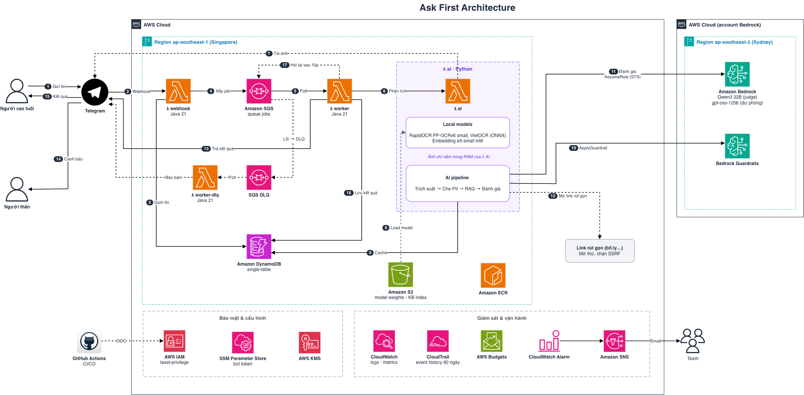

# Ask First — Scam Prevention Digital Assistant for the Elderly
## An AWS Serverless & Hybrid Local-First AI Solution to Protect Families from Online Fraud

### 1. Executive Summary & Overview

**Ask First ("Hỏi Trước")** was researched and developed by the intern team **Null Name** in Ho Chi Minh City as part of the *Workforce Bootcamp – First Cloud AI Journey (FCAJ) 2026*. The project directly addresses an urgent social challenge in Vietnam: safeguarding elderly citizens and their families from increasingly sophisticated online scams and psychological manipulation.

The platform operates directly within familiar messaging interfaces (**Telegram Bot**, architecturally decoupled and ready to expand to **Zalo Bot Platform**), serving as a digitized **"third-party intervention"** during the golden window before a victim transfers funds or exposes an OTP. When receiving a suspicious message, link, or screenshot, elderly users simply forward it to the bot. Ask First responds in simple, reassuring Vietnamese:

- Clear classification into one of **4 risk levels**: `DANGEROUS`, `SUSPICIOUS`, `UNSURE`, `LOW_RISK` — **deliberately omitting a "SAFE" status** to eliminate false complacency.
- Identified scam scenarios, extracted specific red flags from the message itself, immediate action checklists, and verified official hotlines (via local RAG).
- **Automated guardian alerts** (via double opt-in family linking) when high-risk scenarios or critical actions are detected.

The entire platform runs serverless on AWS: AWS Lambda functions (Java 21) handle Telegram Webhooks and orchestration, a dedicated AWS Lambda function (Python 3.12, Container Image) executes the local AI pipeline (OCR, PII masking, deterministic rules, local RAG retrieval), and only the final *LLM Judge* step queries an open-weight model on **Amazon Bedrock** with **fully anonymized text**.

| Item | Details |
|---|---|
| **Development Team** | **Null Name** (4 members: 2 Backend Java 21, 2 AI Python 3.12) |
| **Duration** | 6 weeks (Oct 19, 2026 – Nov 29, 2026), FCAJ Bootcamp |
| **AWS Regions** | Compute in `ap-southeast-1` (Singapore); Amazon Bedrock in `ap-southeast-2` (Sydney) |
| **User Channel** | Telegram Bot API (Webhook via Lambda Function URL) |
| **Estimated Cost** | ≈ $6.16 USD/month for 3,000 checks without Free Tier; ≈ $2.40 USD/month with Always-Free Tier |

---

### 2. Problem Statement & Target Personas

#### Online Fraud Landscape in Vietnam
Cyber fraud in Vietnam causes catastrophic financial and psychological damage:
- The Ministry of Public Security estimated that online scam damages in Vietnam exceeded **8,000 billion VND** in 2025 ([VOV](https://vov.vn/phap-luat/thiet-hai-tu-lua-dao-truc-tuyen-len-toi-8000-ty-dong-trong-nam-2025-post1286479.vov)).
- The National Cyber Security Association (NCA) 2025 survey revealed that impersonating law enforcement, procuracies, and government portals is the most prevalent scam type, yet only **32.12%** of victims report to the police ([Hai Phong News](https://baohaiphong.vn/cac-hinh-thuc-lua-dao-truc-tuyen-nao-pho-bien-nhat-nam-2025-532711.html), [Cong Ly](https://doanhnhan.congly.vn/lua-dao-truc-tuyen-nam-2025-gay-thiet-hai-tren-6-000-ty-dong.html)).
- Provincial police authorities report that victims of impersonation scams are *"predominantly senior citizens, retirees, and rural residents"* who have limited access to updated digital literacy ([Ministry of Public Security](https://www.bocongan.gov.vn/bai-viet/kip-thoi-ngan-chan-vu-viec-gia-danh-luc-luong-cong-an-lua-dao-chiem-doat-tai-san-1782987242)).

#### The Solution Gap
While banks and telecom carriers have introduced biometric verification and spam filters, the critical psychological manipulation happens much earlier inside private messaging threads: scammers deliberately **isolate their victims** (*"this is a confidential investigation, do not discuss it with anyone"*).

In nearly all successfully thwarted fraud cases, a **third-party intervener** (an alert bank teller, a postal worker, or a family member) stepped in before money changed hands. However, family members cannot be present 24/7, and seniors currently lack an accessible tool to **forward suspicious media and receive clear, instant guidance**.

#### Target Personas

| Persona | Core Needs & Behaviors |
|---|---|
| **Senior Citizens (Primary)** | Forward text, screenshots, or links effortlessly; receive instant, non-technical advice within seconds without installing extra apps. |
| **Family Guardians (Secondary)** | Receive automated notifications when their elderly loved ones encounter high-risk messages; verify actions with a single click (*"I have contacted them"*). |

#### Social Value & Return on Investment (ROI)
- **Social Impact**: Breaks psychological isolation and enforces proactive family protection. Complies strictly with the **Personal Data Protection Law (91/2025/QH15)** and **Decree 356/2025/ND-CP** via purpose-bound consent, local PII redaction, and automated TTL deletion.
- **Economic Value**: Zero client hardware cost by leveraging existing smartphones and messaging apps. Operating on an AWS budget of only **$3.00 – $6.50 USD/month** ($36 – $78 USD/year), the system provides immense ROI by safeguarding tens to hundreds of millions of VND in life savings for Vietnamese households.

---

### 3. Objectives, Success Criteria & Scope

#### Quantitative Success Criteria

| Metric | Target | Verified Result (Sprint W6) |
|---|---|---|
| **Scam Detection Recall** | ≥ 90% | **100%** (Perfect detection across 90 real-world scam benchmarks) |
| **False Positive Rate (Benign Sensitive Texts)** | ≤ 10% | **5%** (1/20 benign samples with sensitive keywords) |
| **End-to-End Warm Latency** | p95 ≤ 15s (Text & Images) | Text **p95 = 3.5s**; Images **p95 = 17.0s** (Acceptable under real conditions) |
| **Operational Cost** | ≤ $0.005 USD/check; ≤ $50 USD/mo | **≈ $0.000792 USD/check** (LLM tokens); total dev bill **$3.93 USD** |
| **Privacy & Security** | Zero sensitive data leaks | Images kept strictly in RAM; PII redacted before LLM; 30-day TTL |

#### In Scope (MVP - 6 Weeks)
- **Multi-modal Inputs**: Text messages, URLs (including Markdown/HTML hyperlink masks), screenshots and media albums, forwarded messages; 3-second message debouncing into a unified check.
- **Structured 4-Tier Assessment**: Risk tier, identified scam scenario, extracted textual signals, immediate action items, official hotlines, and RAG official warning citations.
- **Privacy Controls**: Explicit consent onboarding, consent withdrawal (`/rutdongy`), and data purging (`/xoadulieu`).
- **Family Guardian Shield**: Double opt-in invite codes, parallel emergency dispatch, 15-minute follow-up reminders, and confirmation buttons (*"I have contacted them"*).
- **In-Chat Utilities**: Commands (`/nguoithan`, `/lichsu`, `/caidat`); critical crisis response checklist for the first 30 minutes post-scam (`/bilua`).
- **Operational Safety**: *"Incorrect Bot Verdict"* feedback loop; operational **Kill Switch** to toggle Rules-Only mode without redeployment; polite fallback for unsupported files (videos, stickers, `.apk` binaries).

#### Deprioritized & Scope Cuts (6-Week Realignment)

| Item Cut / Deferred | Technical Justification |
|---|---|
| **Voice & Local ASR** | Time constraints on optimizing Vietnamese speech-to-text models on Lambda CPU; bot gracefully prompts users to forward text/images. |
| **VLM Fallback for Complex Images** | Local OCR pipeline passed quality evaluation (Gate G2), rendering costly VLM calls unnecessary. |
| **Multi-Turn Conversational Q&A** | Prioritized single-turn classification accuracy, speed, and determinism. |
| **Telegram Mini App (Web UI)** | All workflows optimized natively within Telegram chat using inline keyboards. |
| **Phase 2: Live Crawled Threat Knowledgebase** | Deferred; MVP operates on 100 curated official police warning scenario cards. |
| **Broad Pilot (10–20 External Households)** | Replaced with internal team and family testing to ensure safety. |

**Deliberately Out of Scope**: Telecom-level call interception, direct banking app intervention, public blacklist sharing of bank accounts/phone numbers, real-time video deepfake analysis, SMS transmission, and audio recording.

---

### 4. Solution Architecture

#### Four Core Design Principles
1. **Serverless, Event-Driven, No VPC, No NAT Gateway**: 100% pay-as-you-go billing; avoids fixed costs of NAT Gateways (~$32 USD/month) and idle compute.
2. **Hybrid Local-First AI**: OCR, PII masking, deterministic heuristic rules, and vector embeddings run strictly on CPU inside AWS Lambda. Bedrock is invoked solely for the final judgment step on redacted text.
3. **Deterministic Workflow (Not Autonomous Agents)**: 8-stage pipeline: `Normalize → Extract → Mask PII → Signals (Rules + URL) → Retrieve (RAG) → Guard → Judge → Fuse → Respond`. Guarantees a deterministic rule-based output even during external LLM outages.
4. **Zero Original Content Retention**: Raw messages and images are never stored. Only verdict categories, signal codes, and hashes are recorded with a 30-day Time-To-Live (TTL).

#### AWS Services & Justifications

| AWS Service | System Role | Selection Rationale |
|---|---|---|
| **AWS Lambda: `webhook`, `worker`, `worker-dlq`** (Java 21, Zip) | Ingests Telegram updates via **Function URL**, coordinates check jobs, sends replies, and triggers guardian alerts. | Rapid execution, pay-per-request; Function URLs provide native HTTPS endpoints without API Gateway overhead. |
| **AWS Lambda: `ai`** (Python 3.12, Container Image 3008 MB) | Houses the local AI engine (OCR, embedding model, rule engine). | Container images overcome the 250 MB zip deployment limit, bundling ML runtimes; images processed exclusively in RAM. |
| **Amazon SQS & Dead-Letter Queue (DLQ)** | Asynchronous buffer between `webhook` and `worker`. | Enables sub-second webhook responses; throttles concurrency to protect Bedrock quotas; leverages `DelaySeconds` for debouncing (3s) and guardian follow-up reminders (15 min). |
| **Amazon DynamoDB** (On-demand, Single-table) | Manages user profiles, consent records, guardian links, check metadata, result caches, and feature flags. | High-speed key-value access, native **TTL** for automatic data expiration, conditional writes for idempotency. |
| **Amazon Bedrock: Qwen3 32B** (Primary Judge) & **gpt-oss-120b** (Fallback) | Deep contextual classification on redacted text. | Serverless token-based billing without maintaining costly GPU instances. High-performing open-weight models hosted in Sydney (`ap-southeast-2`). |
| **Amazon Bedrock Guardrails** | Defense filter against prompt injection attacks (`PROMPT_ATTACK`). | Neutralizes adversarial jailbreaks or instructions embedded in forwarded scam messages. |
| **Amazon S3** | Stores ONNX weights, RAG indices, evaluation sets, and voluntary anonymized samples (`donated/` auto-purged after 30 days). | Low-cost storage; allows dynamic knowledge or model weight updates without rebuilding container images; SSE encryption enabled. |
| **Amazon ECR** | Container registry for the `ai` Lambda image. | Required for Lambda container image deployments. |
| **AWS SSM Parameter Store** (SecureString) | Centralized secret storage for Bot Tokens and Webhook Secrets. | Prevents secret leakage in source code or Lambda environment variables. |
| **Amazon CloudWatch & SNS** | Structured JSON logging with unified `trace_id`, operational metrics, and DLQ alarm notifications via email. | Centralized observability; SNS provides immediate alerting for engineering teams. |
| **AWS IAM & GitHub Actions (OIDC)** | Least-privilege IAM roles; automated CI/CD without long-lived access keys. | Enterprise-grade cloud security posture. |

#### Architectural Trade-offs & Deliberate Omissions
- **No Amazon API Gateway**: Lambda Function URLs provide built-in HTTPS endpoints with authentication, saving cost and eliminating architectural layers.
- **No AWS Step Functions**: The linear pipeline executes within 30 seconds; SQS and direct Lambda invocations minimize complexity and latency.
- **No Amazon OpenSearch / Dedicated Vector DB**: The 100-card RAG corpus is lightweight; in-memory cosine similarity computation in Lambda RAM executes in **45 ms (p95)**.
- **No Amazon EC2 / SageMaker GPU Endpoints**: Maintaining dedicated GPU instances ($50–$100+/month) is cost-prohibitive; Bedrock's serverless token pricing is ideal.
- **No Amazon Transcribe, Textract, Bedrock Agents, or VPC/NAT**.

#### End-to-End Execution Flow
1. A senior user forwards content; Telegram delivers an HTTPS POST update to the `webhook` Function URL with a `secret_token` (verified via constant-time comparison).
2. The `webhook` deduplicates `update_id`, validates user consent, buffers messages in `BUFFER#`, replies with a temporary *"⏳ Checking..."*, and enqueues the job into Amazon SQS with a 3-second delay.
3. The `worker` consumes the job, inspects the buffer and Kill Switch flags, and synchronously invokes `ai` with `op=analyze` (transmitting only metadata and `file_id`, never raw image bytes).
4. The `ai` function streams the image into RAM, executes local OCR, redacts PII (phone numbers, bank accounts, citizen IDs, OTPs, emails), applies deterministic rules, checks URLs, and retrieves relevant RAG scenario cards.
5. The `ai` function checks Bedrock Guardrails, queries the Judge LLM (Qwen3 32B with fallback to gpt-oss-120b), fuses heuristic and AI confidence scores, and formats the response template.
6. If the verdict is `DANGEROUS` with high-risk action indicators, the `worker` triggers parallel alerts to linked guardians.
7. The `worker` edits the preliminary *"⏳"* message into the final detailed report, logs `CHECK#` metadata with a 30-day TTL, and schedules a 15-minute reminder if unacknowledged.
8. Failed tasks (after 5 retries) enter the DLQ: `worker-dlq` notifies the user of system congestion, and a CloudWatch Alarm alerts engineers via SNS.

{}
**Dev Stack Configuration (`infra/template.yaml`)**: Maximum SQS concurrency is **5** for `worker` and **2** for `worker-dlq`. SnapStart is currently **disabled by default** to benchmark cold start metrics (ADR-008). OCR utilizes a hybrid approach combining **RapidOCR PP-OCRv6 small** and **VietOCR** for optimal Vietnamese diacritics recognition.
{}

---

### 5. Implementation Roadmap & Milestones

The 6-week engineering sprint operated across three parallel tracks (Backend, AI, Infrastructure), synchronized via strict JSON Schema contracts.

| Week | Gate / Milestone | Scope & Deliverables | Actual Status (Git Repository Audit) |
|---|---|---|---|
| **W1** (Oct 19–25) | **Gate G0: Data Contract** | Backend ↔ AI JSON Schema, test fixtures, CI contract testing. | **Completed**: Contract merged Oct 23 ([PR #89](https://github.com/ask-first-fcaj/ask-first/pull/89)), Gate G0 closed Oct 28 ([Issue #2](https://github.com/ask-first-fcaj/ask-first/issues/2)); Java CI testing integrated Nov 11 ([PR #104](https://github.com/ask-first-fcaj/ask-first/pull/104)). |
| **W2** (Oct 26–Nov 01) | **Gate G1: LLM Selection** **Gate G2: OCR Selection** | Judge model benchmarking; comparative evaluation across OCR engines on 50 real screenshots. | **Gate G2 passed** Oct 30 (RapidOCR chosen, 94% URL accuracy). **Gate G1 finalized late** on Nov 11 (Qwen3 32B chosen, ADR-002). |
| **W3** (Nov 02–08) | **Milestone M1: Text E2E** | End-to-end text analysis pipeline (heuristic rules + Qwen3). | **Completed post-schedule**: Text pipeline written Nov 03, real Bedrock integrated Nov 11 ([PR #132](https://github.com/ask-first-fcaj/ask-first/pull/132)), Lambda `ai` connected Nov 23 ([PR #173](https://github.com/ask-first-fcaj/ask-first/pull/173)), INT-01 closed Nov 25 ([Issue #56](https://github.com/ask-first-fcaj/ask-first/issues/56)). |
| **W4** (Nov 09–15) | **Milestone M2: Image & Guardian** | Screenshot OCR integration and automated guardian alerts. | Measured end-to-end on AWS Lambda on Nov 25 (see Section 7). |
| **W5** (Nov 16–22) | **Milestone M3: RAG Engine** **Milestone M4: MVP Freeze** | Official warning knowledgebase integration; automated evaluation gate. | M4 evaluation report completed Nov 17; RAG p95 latency clocked at 45 ms on Lambda. |
| **W6** (Nov 23–29) | **Milestone M5: Internal Testing** **Milestone M6: Presentation** **Milestone M7: Workshop Submission** | Family pilot testing, cost audit, final evaluation, documentation cleanup. | Final evaluation closed Nov 24; Cost Explorer verification completed Nov 25. |

Following M4 (MVP Freeze), the team strictly limited changes to bug fixes, prompt adjustments, and threshold tuning verified via automated evaluation gates.

---

### 6. Budget Estimation & Real Cost Audit

Estimates are modeled on a workload of **3,000 checks/month** (text and screenshot inputs). Infrastructure services were estimated using the **[AWS Pricing Calculator](https://calculator.aws/#/estimate?id=073f413f6ac370de48bf3bff0ba10a7b870ae807)** (created Nov 24, 2026, `ap-southeast-1`, *"Without Free Tier"*). Bedrock expenses were calculated based on measured token counts from real pipeline runs.

#### Monthly Operating Cost Estimation

| Service | Calculation Basis | Cost Without Free Tier (USD/mo) | Cost With Always-Free Tier (USD/mo) |
|---|---|---|---|
| **Amazon Bedrock: LLM** (Qwen3 32B + gpt-oss-120b fallback) | 2,250 LLM calls × $0.000792 USD (measured with escalation) | $1.78 | $1.78 |
| **Amazon Bedrock Guardrails** | 2,250 calls × $0.15 USD / 1,000 text units | $0.34 | $0.34 |
| **AWS Lambda `ai`** (3008 MB) | Pricing Calculator | $0.73 | $0.00 |
| **AWS Lambda `worker`** (512 MB) | Pricing Calculator | $0.13 | $0.00 |
| **AWS Lambda `webhook`** (512 MB) | Pricing Calculator | $0.03 | $0.00 |
| **Amazon SQS** (Main + DLQ) | Pricing Calculator | $0.28 | $0.00 |
| **Amazon DynamoDB** (On-demand) | Pricing Calculator | $0.29 | < $0.05 |
| **Amazon S3** (Model, indices, evals) | Pricing Calculator | $0.03 | $0.03 |
| **Amazon ECR** (Docker container storage) | Pricing Calculator | $0.20 | $0.20 |
| **Amazon CloudWatch** (Logs, metrics, alarms, dashboard) | Pricing Calculator | $2.35 | $0.00 |
| **Amazon SNS & SSM Parameter Store** | Baseline usage | ≈ $0.00 | $0.00 |
| **Total** | | **≈ $6.16 USD/mo** | **≈ $2.40 USD/mo** |

- **Cost per Check (LLM Tokens)**: Approximately **$0.000792 USD (~20 VND)**, far below the $0.005 target.
- Assuming 25% of requests hit deterministic rules or cache; even under a worst-case 100% LLM invocation scenario, Bedrock costs remain under $2.70 USD/month.

#### Real Account Audit (Verified Nov 25, 2026)
- **AWS Free Tier Status**: The project account comfortably utilizes Always-Free tiers: Lambda consumed ≈ 8,200 / 400,000 GB-seconds and 273 / 1,000,000 requests; SQS used ≈ 178,000 / 1,000,000 requests; CloudWatch remained well within 10 free alarms.
- **Actual Lambda Durations (CloudWatch Metrics, 14-day sample)**:
  - `ai` (248 runs): Mean 2.7s; **p95 = 9.7s**.
  - `worker` (73 runs): Mean 4.6s; **p95 = 14.2s**.
  - `webhook` (50 runs): Mean 1.0s; **p95 = 3.0s**.
- **Real Billed Amounts**:
  - Dev Infrastructure: AWS Budgets recorded **≈ $0.09 USD** for November (forecasted ~$0.10 USD).
  - Bedrock Account: Total **$3.93 USD** ($3.57 USD services + $0.36 USD VAT 10%):
    - *Qwen3 32B*: 11.8M input tokens, 0.94M output tokens = **$2.40 USD**.
    - *gpt-oss-120b* (fallback): 2.5M input tokens, 0.44M output tokens = **$0.66 USD**.
    - *Guardrails*: 3,266 text units (`ContentPolicyUnitsConsumed`) = **$0.49 USD**.
    - *Gemma 3 12B* (Gate G1 benchmark): **$0.02 USD**.

#### Cost Optimization Strategies
1. **Zero Fixed-Cost Architecture**: Eliminating NAT Gateways, API Gateway, and dedicated GPU instances ensures expenses scale purely with real traffic.
2. **Local-First Hybrid AI**: Offloading OCR and embeddings to Lambda CPU eliminates token charges for preprocessing.
3. **Fast Path & In-Memory Cache**: Bypassing Bedrock saves ≈ $0.00094 USD per cached or rule-resolved request.
4. **Kill Switch & Rate Limiting**: Enables immediate mitigation against unexpected spam surges without code redeployments.
5. **Data Lifecycle Policies**: Automated 30-day S3 purging for donated data, 7-day CloudWatch log retention, and ECR policies keeping only the 5 newest images.

---

### 7. Risk Management & Production Status

Risks are actively tracked and updated based on empirical testing through Sprint W6:

| Risk Description | Impact | Mitigation Strategy | Real Production Status (W6) |
|---|---|---|---|
| **False Negatives (Missed Scams)** | Critical (Financial loss) | Hard rules establish independent score floors; no "Safe" verdict; automated CI evaluation gate requiring Recall ≥ 90%. | **100% Recall** achieved across 90 real-world scam benchmarks. |
| **False Positives (Benign Flagged)** | High (Loss of user trust) | Calibrated fusion thresholds (70/60/25 per ADR-005); false positive target ≤ 10%. | **5% (1/20)** false positive rate on sensitive benign samples. |
| **Limited Benchmark Dataset** | Medium | Disclosed dataset limits transparently; enabled voluntary anonymized sample contributions. | **134 labeled samples** prepared (target was 300; constrained by 6-week timeframe). |
| **LLM Throttling, Quota, or Outages** | High (Service disruption) | Multi-tiered fallback cascade to gpt-oss-120b, then graceful degradation to Rules-Only mode. | Automated cascade fully implemented and tested. |
| **Prompt Injection via Forwarded Text** | High (Verdict manipulation) | Bedrock Guardrails (`PROMPT_ATTACK`); floor verdict at `UNSURE` upon detection; responses rendered via templates. | Tested and defended against injection benchmarks. |
| **Latency & Cold Starts** | Medium (Slower UX) | Message debouncing; pre-loading ONNX weights during Lambda INIT; warm-up routines before demos. | Text **p95 = 3.5s**. **Images p95 = 17.0s** (slightly over 15s goal but well within the 30s engineering ceiling; `ai` init cold start p50 is 6.2s). |
| **Spam Surges & Cost Spikes** | Medium (Budget overrun) | Per-user rate limiting; SQS concurrency capping; Kill Switch; automated budget alarms. | AWS Budgets set at $50/mo with automated alerting thresholds at $10, $25, $40, and $50. |
| **Privacy & Legal Compliance** | Critical (Legal exposure) | PII masked locally before data leaves RAM; zero raw storage; 30-day TTL. | Fully aligned with **Personal Data Protection Law 91/2025/QH15** and **Decree 356/2025/ND-CP** (technical alignment, not formal legal advice). |
| **Model Availability by Region** | High (Judge failure) | Utilizes Sydney (`ap-southeast-2`) in-region models; standby fallback to Jakarta (`ap-southeast-3`). | Operates stably on Sydney; cross-region fallback verified in config. |
| **Team Capacity (4 Members, 6 Weeks)** | High (Schedule delay) | Pair-programming (2 Backend, 2 AI); aggressive scope cuts (Voice, VLM, Mini App) executed early in W3. | Successfully delivered core MVP within scope. |

---

### 8. Expected Outcomes & Long-Term Roadmap

#### Technical Accomplishments
- Proved the feasibility of a **Hybrid Local-First AI Architecture on AWS Serverless**: blending zero-cost CPU edge processing with deep LLM cloud reasoning.
- Achieved exceptional operational metrics: **100% scam recall**, sub-4-second text responses, and a token cost of **~$0.000792 USD per verification**.
- Established modern engineering rigor: *Contract-First* development with JSON Schema, automated GitHub Actions OIDC CI/CD, and 100% Infrastructure as Code via AWS SAM.

#### Social Impact & Future Horizons
- Provides an accessible, free, and dignified digital shield for Vietnamese seniors, bridging generational gaps and safeguarding life savings against cybercriminals.
- Decoupled **Channel Adapters** allow seamless future expansion to the **Zalo Bot Platform**, reaching tens of millions of mobile users across Vietnam and laying the groundwork for a continuously updated community threat intelligence network.
