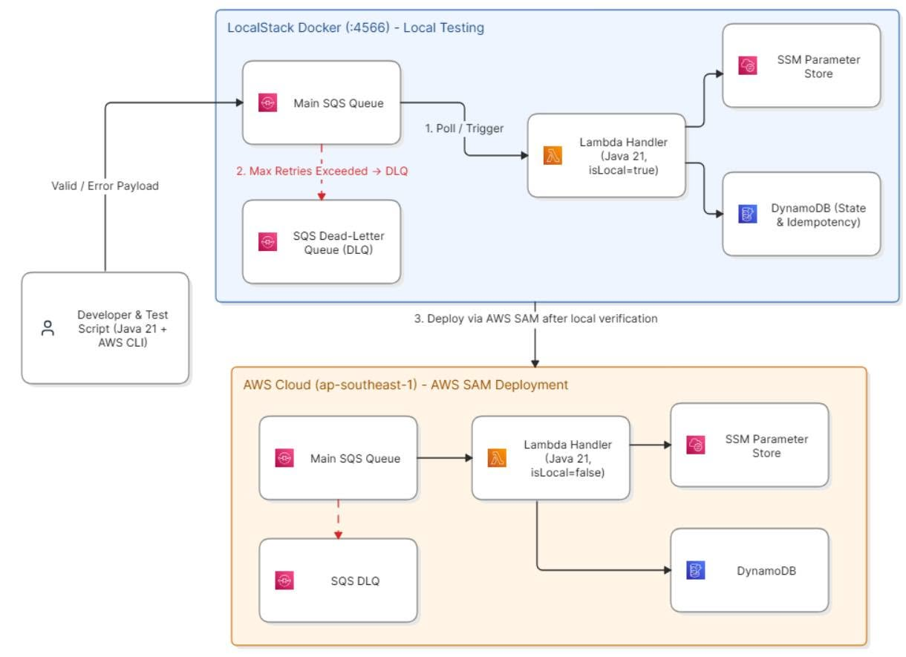
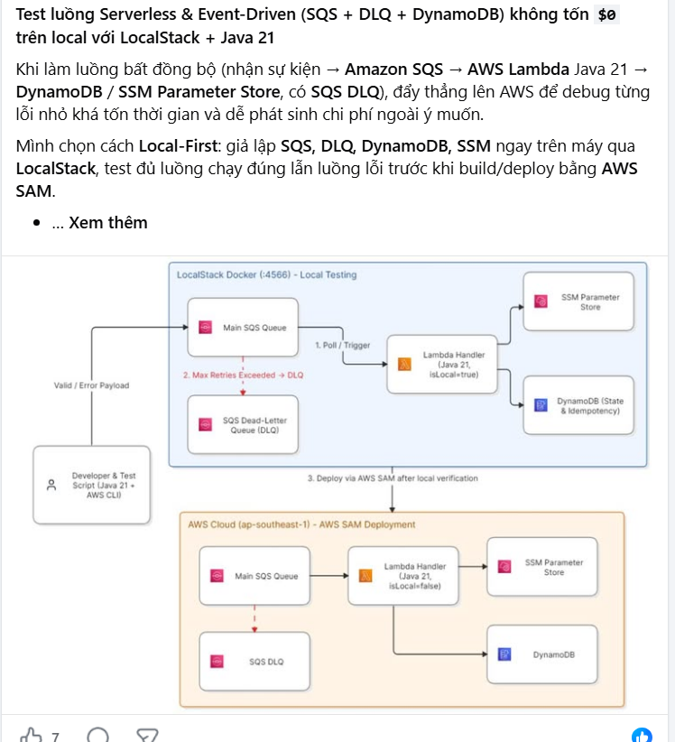

# LOCAL-FIRST SERVERLESS & EVENT-DRIVEN TESTING WITH LOCALSTACK AND JAVA 21

When developing event-driven serverless applications on AWS—such as ingesting webhook events into **Amazon SQS**, processing messages asynchronously via **AWS Lambda (Java 21)**, storing state in **Amazon DynamoDB**, reading configuration from **AWS Systems Manager (SSM) Parameter Store**, and routing failed payloads to an **SQS Dead-Letter Queue (DLQ)**—deploying directly to the cloud for every minor code or configuration change slows down iteration and risks unintended costs.

This blog shares a **Local-First testing workflow** using **LocalStack** and **Java 21 (AWS SDK v2)** to validate both normal execution paths and failure/DLQ behaviors locally before deploying to AWS with **AWS SAM**.

Key points covered in the post:

- **Environment-based Endpoint Separation in AWS SDK v2:** Overriding service endpoints (`endpointOverride`) to target LocalStack (`http://localhost:4566`) only when running in local mode (`isLocal = true`), while keeping default AWS endpoints in production.
- **Full Event-Driven Emulation in Docker:** Spinning up SQS, DLQ, DynamoDB, SSM Parameter Store, S3, IAM, and Lambda locally using a lightweight `docker-compose.yml` setup in `ap-southeast-1`.
- **End-to-End Happy Path & DLQ Verification:** Testing valid payloads to verify DynamoDB state persistence and message deletion from the main queue, alongside intentionally malformed payloads to confirm retry exhaustion and automatic routing to the **SQS DLQ**.
- **Safer & Faster AWS SAM Deployment:** Catching missing parameters, null-handling issues, and queue misconfigurations at `$0` local cost before packaging and deploying the stack to AWS Cloud.

### Architecture & Illustrations

### Post Links
- **Facebook Post Link:** [AWS Study Group VN | Testing Serverless & Event-Driven Flows (SQS + DLQ + DynamoDB) at $0 on Local with LocalStack + Java 21](https://www.facebook.com/groups/awsstudygroupfcj/posts/2349976352433990/?notif_id=1795670899925015&notif_t=group_post_approved&ref=notif)
- **Reference Setup & Code Snippets:** Included `docker-compose.yml` for LocalStack (`:4566`) and Java 21 `SqsClient` endpoint configuration in the post.
