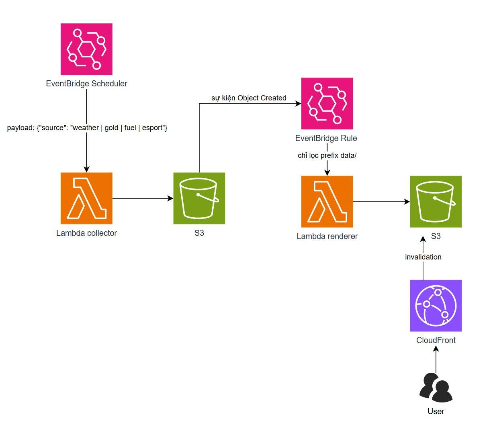
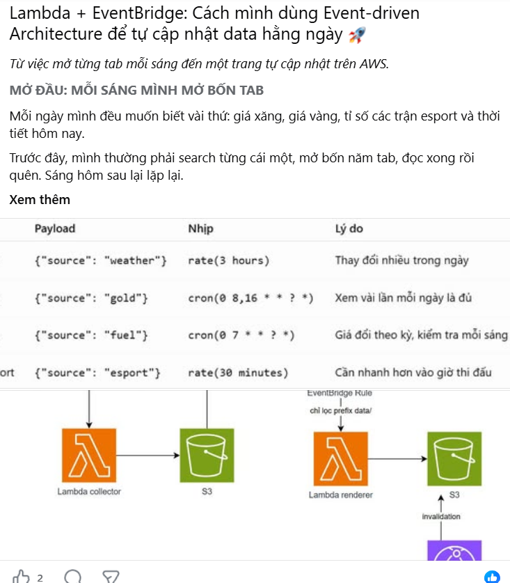

# LAMBDA + EVENTBRIDGE: DAILY DATA AUTOMATION WITH EVENT-DRIVEN ARCHITECTURE

This blog post documents an event-driven architecture on AWS that replaces manual daily checks for fuel prices, gold prices, esports match scores, and weather with a single auto-updating static web page served via Amazon S3 and Amazon CloudFront. Instead of running an always-on server or a monolithic script where one failing API breaks the entire page, Amazon EventBridge Scheduler, AWS Lambda, and EventBridge Rules decouple data collection from page rendering.

Key points to know:

- **Independent schedules per source:** Amazon EventBridge Scheduler triggers a shared Lambda collector asynchronously with source-specific payloads (`weather`, `gold`, `fuel`, `esport`) and local time-zone support, matching each source's update cadence (such as every 30 minutes for esports scores, every 3 hours for weather, and daily/weekly for fuel and gold) with retry policies and a dead-letter queue.
- **Normalized storage and fault isolation:** A single Python Lambda collector fetches external APIs, normalizes payloads into `data/<source>.json` in Amazon S3, and avoids overwriting prior data when a source fails so existing values stay visible.
- **Prefix-filtered event chaining:** S3 Object Created events sent to EventBridge use a rule matching prefix `data/` to invoke a Lambda renderer—preventing an infinite loop when the renderer writes `index.html` to the same bucket.
- **Idempotent rendering and cache invalidation:** The renderer reads available source JSON files (showing `"chưa có"` when missing) plus each source's `updatedAt` timestamp, rebuilds `index.html` idempotently for at-least-once delivery, and triggers a CloudFront invalidation on `/index.html`.
- **Extensible serverless footprint:** Adding a new data source requires adding a normalizer and schedule without rewriting the rendering pipeline or maintaining a 24/7 server.

This pattern fits personal dashboards and lightweight aggregation pipelines where each data feed updates on its own schedule, degrades gracefully when an upstream API fails, and scales to new sources with minimal operational overhead.

### Architecture & Illustrations

### Post Links
- **Facebook Post Link:** [AWS Study Group VN | Lambda + EventBridge: Daily Data Automation with Event-Driven Architecture](https://www.facebook.com/groups/660548818043427/?multi_permalinks=2345717436193215)
- **Architecture & Implementation:** Combines Amazon EventBridge Scheduler to trigger AWS Lambda asynchronously, stores normalized JSON payloads in Amazon S3, and distributes static content securely via Amazon CloudFront.
