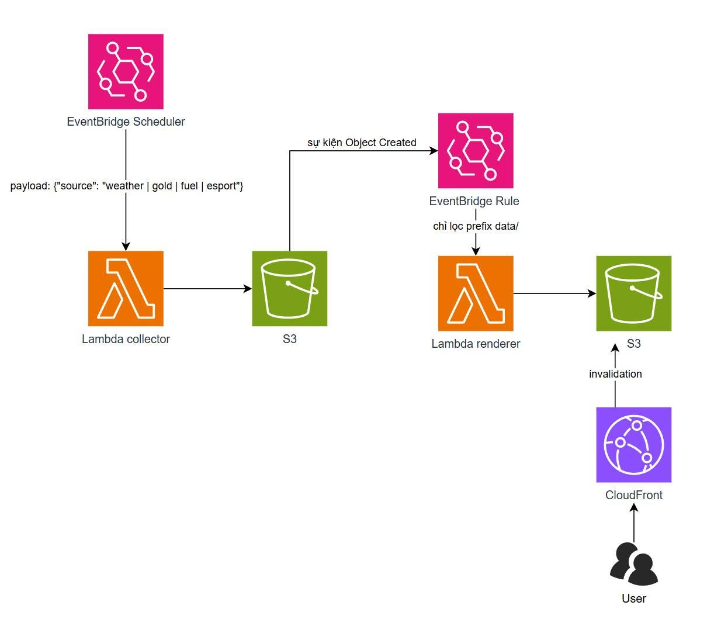
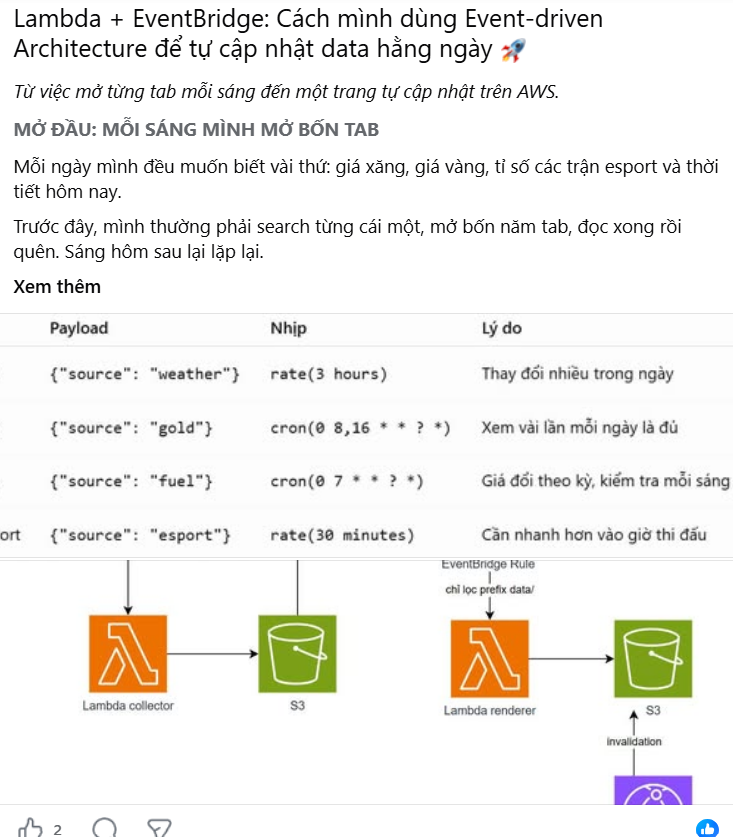

# LAMBDA + EVENTBRIDGE: TỰ ĐỘNG CẬP NHẬT DỮ LIỆU HẰNG NGÀY VỚI EVENT-DRIVEN ARCHITECTURE

Bài báo cáo tóm tắt cách xây dựng kiến trúc event-driven trên AWS để thay thế việc mở nhiều tab kiểm tra giá xăng, giá vàng, tỉ số esport và thời tiết mỗi sáng bằng một trang tĩnh tự cập nhật qua Amazon S3 và Amazon CloudFront. Thay vì duy trì server chạy 24/7 hoặc một script tuần tự dễ gãy khi một API lỗi, hệ thống kết nối Amazon EventBridge Scheduler, AWS Lambda và EventBridge Rules theo từng sự kiện độc lập.

Các điểm chính cần nắm:

- **Lịch chạy riêng cho từng nguồn:** EventBridge Scheduler gọi Lambda collector bất đồng bộ kèm payload theo từng nguồn (`weather`, `gold`, `fuel`, `esport`) và hỗ trợ múi giờ địa phương, khớp nhịp cập nhật riêng (ví dụ 30 phút cho esport, 3 giờ cho thời tiết, hằng ngày/tuần cho giá xăng và vàng) cùng retry policy và dead-letter queue.
- **Chuẩn hóa dữ liệu và cô lập lỗi:** Một hàm Lambda collector viết bằng Python lấy dữ liệu, chuẩn hóa thành `data/<nguồn>.json` trên S3, và không ghi đè file cũ khi nguồn gặp lỗi để trang vẫn giữ số liệu trước đó.
- **Lọc prefix để tránh lặp vô tận:** Sự kiện Object Created từ S3 gửi sang EventBridge được lọc theo prefix `data/` trước khi gọi Lambda renderer, nhờ đó việc ghi `index.html` vào cùng bucket không kích hoạt lại chính renderer.
- **Thiết kế idempotent và làm mới cache:** Lambda renderer đọc các file JSON hiện có (hiển thị `"chưa có"` nếu thiếu) kèm `updatedAt` của từng nguồn, dựng lại `index.html` theo hướng idempotent để chịu được cơ chế giao sự kiện at-least-once, sau đó tạo CloudFront invalidation cho `/index.html`.
- **Dễ mở rộng và tiết kiệm chi phí:** Khi cần thêm nguồn dữ liệu mới, chỉ cần bổ sung hàm chuẩn hóa và lịch tương ứng mà không phải sửa toàn bộ luồng dựng trang hay vận hành máy chủ liên tục.

Mô hình này phù hợp cho các trang tổng hợp thông tin cá nhân cần cập nhật theo nhiều nhịp khác nhau, giữ tính ổn định khi một nguồn gián đoạn và dễ mở rộng thêm nguồn mới với chi phí thấp.

### Sơ đồ kiến trúc & Hình ảnh minh họa

### Liên kết bài viết
- **Link bài viết trên Facebook:** [AWS Study Group VN | Lambda + EventBridge: Tự động cập nhật dữ liệu hằng ngày với Event-Driven Architecture](https://www.facebook.com/groups/660548818043427/?multi_permalinks=2345717436193215)
- **Mô hình kiến trúc & Triển khai:** Sử dụng Amazon EventBridge Scheduler kích hoạt AWS Lambda bất đồng bộ, lưu trữ tệp chuẩn hóa JSON trên Amazon S3 và phân phối tĩnh an toàn qua Amazon CloudFront.
