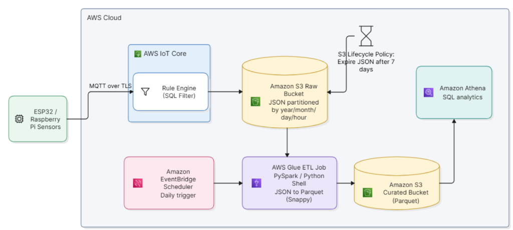

# [EXPERIENCE SHARING] DESIGNING A COST-OPTIMIZED IOT DATA PIPELINE (MQTT → AWS IOT CORE → GLUE → S3) FOR SMALL-SCALE PROJECTS

When starting out with IoT projects (such as weather stations using ESP32/Raspberry Pi), many students stop at forwarding telemetry over MQTT to a visual dashboard. However, when the system runs 24/7 for months, a real-world dilemma emerges: **millions of tiny JSON messages accumulate, inflating storage and API request bills, slowing queries down, and making raw telemetry difficult to analyze.**

Below is a Serverless architecture that captures and optimizes sensor data long-term on AWS with near-zero operating costs for student capstones and lightweight workloads.

### Solution Architecture Diagram



---

### 1. The Common Pitfall: The "Small Files Nightmare"

Suppose an ESP32 sensor emits 1 JSON payload of ~`200 bytes` every 10 seconds (`device_id`, `temp`, `humidity`, `timestamp`).

* **1 day:** 8,640 messages per device.
* **10 devices over 3 months:** ~7.7 million tiny JSON files in S3.

Leaving this raw state causes:
1. **Excessive API Request Costs:** Amazon S3 charges per `PUT` and `GET` operation. Accumulating millions of tiny files drives API request charges far higher than actual storage costs.
2. **Slow & Expensive Analytics:** Querying raw JSON via Amazon Athena forces the engine to open and parse millions of individual objects, resulting in long latencies and high scanning costs (Athena charges per TB scanned).

---

### 2. Solution Architecture (Serverless & Zero-Server)

The data flow is decoupled into two distinct tiers: **Hot (Raw Ingestion)** and **Cold (Compaction & Optimization)**:

$$\text{Sensors (ESP32/Pi)} \xrightarrow{\text{MQTT/TLS}} \text{AWS IoT Core (Rule)} \rightarrow \text{S3 Raw Zone (JSON)} \xrightarrow{\text{AWS Glue ETL (Scheduled)}} \text{S3 Curated Zone (Parquet)}$$

#### Step 1: Direct Routing from AWS IoT Core to S3 with Time-Based Partitioning
Instead of provisioning an EC2 or Lambda compute layer solely to ingest MQTT packets and write to S3, use the built-in **AWS IoT Core Rule Engine**. It filters payloads using SQL syntax and streams directly to S3 with dynamic folder partitioning:

*IoT Rule SQL Configuration:*
```sql
SELECT 
  device_id,
  temperature,
  humidity,
  timestamp() AS server_ts
FROM 'sensors/+/telemetry'
WHERE temperature IS NOT NULL
```

*S3 Action Destination Key (Automated time-based partitioning):*
```text
raw-data/year=${parseTime("yyyy", timestamp())}/month=${parseTime("MM", timestamp())}/day=${parseTime("dd", timestamp())}/hour=${parseTime("HH", timestamp())}/${clientId()}-${timestamp()}.json
```

#### Step 2: Compaction and Parquet Conversion with AWS Glue
At the end of each day, **Amazon EventBridge Scheduler** triggers an **AWS Glue Job** (PySpark or Python Shell) to read the previous day's JSON files, clean data types, coalesce files, and export columnar **Apache Parquet** (Snappy compressed) into the S3 Curated Bucket.

*Core PySpark Glue Script:*
```python
import sys
from awsglue.transforms import *
from awsglue.utils import getResolvedOptions
from pyspark.context import SparkContext
from awsglue.context import GlueContext
from awsglue.job import Job

args = getResolvedOptions(sys.argv, ['JOB_NAME', 'INPUT_PATH', 'OUTPUT_PATH'])
sc = SparkContext()
glueContext = GlueContext(sc)
spark = glueContext.spark_session
job = Job(glueContext)
job.init(args['JOB_NAME'], args)

# 1. Ingest small JSON files from yesterday's partition
raw_df = spark.read.json(args['INPUT_PATH'])

# 2. Type casting & anomaly deduplication
clean_df = (raw_df
    .dropna(subset=["device_id", "temperature"])
    .withColumn("temperature", raw_df["temperature"].cast("double"))
    .withColumn("humidity", raw_df["humidity"].cast("double"))
    .dropDuplicates(["device_id", "server_ts"])
)

# 3. Coalesce into 1 single file and write Snappy-compressed Parquet
(clean_df
    .coalesce(1)
    .write
    .mode("overwrite")
    .option("compression", "snappy")
    .parquet(args['OUTPUT_PATH'])
)

job.commit()
```

#### Step 3: Automated Pruning with S3 Lifecycle Policies
Once data safely resides in the `Curated Zone` in Parquet format, apply an **S3 Lifecycle Rule** on `raw-data/` to automatically delete raw JSON files after **7 days**. This provides a 1-week raw audit window for debugging without accumulating indefinite storage debt.

---

### 3. Empirical Efficiency Comparison (Raw JSON vs. Compressed Parquet)

Simulated scenario with **10 million telemetry records / month** (~2 GB raw JSON):

| Metric | Retaining Raw JSON | Compacted Parquet (Snappy) | Improvement |
| :--- | :--- | :--- | :---: |
| **S3 Storage Footprint** | ~2.0 GB | ~250 MB – 320 MB | **~85% Reduction** |
| **File Count on S3** | 10,000,000 files | ~30 files (1 file/day) | **99.99% Reduction** |
| **Scanned Bytes per Column Query (Athena)** | Scans entire 2.0 GB | Scans only ~40 MB (columnar pruning) | **~98% Query Cost Savings** |
| **Estimated S3 + Athena Costs** | High PUT/GET requests & scan charges | Well within Free Tier / a few cents/month | **Maximum Cost Efficiency** |

---

### 4. Practical Tips to Prevent AWS Glue Billing Spikes

AWS Glue charges per DPU (Data Processing Unit) per second (with a 1-minute minimum on Glue 3.0/4.0). For small workloads:
* **When using Spark:** Select Worker type `G.1X` and set a hard ceiling of `2 Workers`.
* Disable *Job Bookmarks* if explicitly feeding the targeted partition path (`year=.../month=.../day=...`) via `--INPUT_PATH`.
* **For small datasets (< a few hundred MB/day):** Use **AWS Glue Python Shell** (costing only `0.0625 DPU`, 16x cheaper than Spark workers) with `awswrangler` to convert JSON to Parquet within seconds.

---

### Post Links
- **Facebook Community Post:** [Post shared on AWS Study Group](https://www.facebook.com/groups/awsstudygroupfcj)
- **Tags:** `#AWS #AWSStudyGroup #IoT #Serverless #DataEngineering #AWSIoTCore #AWSGlue #AmazonS3 #Athena`
