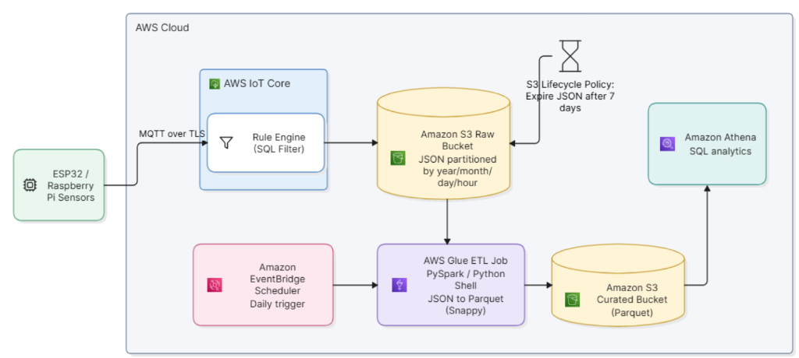

# [CHIA SẺ KINH NGHIỆM] THIẾT KẾ LUỒNG DỮ LIỆU IOT (MQTT → AWS IOT CORE → GLUE → S3) TỐI ƯU CHI PHÍ CHO ĐỒ ÁN QUY MÔ NHỎ

Khi mới làm các dự án IoT (như trạm quan trắc thời tiết dùng ESP32/Raspberry Pi), hầu hết tụi mình thường chỉ dừng ở bước đẩy dữ liệu qua MQTT lên dashboard để xem cho vui mắt. Nhưng khi hệ thống chạy liên tục 24/7 trong vài tháng, bài toán thực tế mới lộ rõ: **hàng triệu bản tin JSON nhỏ lẻ dồn về làm phình chi phí lưu trữ, truy vấn chậm chạp và dữ liệu thô rất khó đưa vào phân tích sau này.**

Dưới đây là cách thiết kế một pipeline Serverless thu thập và tối ưu hóa dữ liệu cảm biến dài hạn trên AWS với chi phí gần như chạm đáy cho quy mô dự án sinh viên hoặc hệ thống nhỏ.

### Sơ đồ kiến trúc giải pháp



---

### 1. Vấn đề của cách làm thông thường: "Cơn ác mộng Small Files"

Giả sử mỗi 10 giây, một thiết bị ESP32 gửi 1 bản tin JSON nặng khoảng `200 bytes` (gồm `device_id`, `temp`, `humidity`, `timestamp`).

* **1 ngày:** 8.640 bản tin / thiết bị.
* **10 thiết bị chạy trong 3 tháng:** ~7,7 triệu file JSON nhỏ lẻ trên S3.

Nếu để nguyên hiện trạng này:
1. **Tốn chi phí API Request:** S3 tính phí theo số lượng `PUT` request khi ghi và `GET` request khi đọc. Hàng triệu file nhỏ khiến phí API cao hơn cả phí lưu trữ.
2. **Truy vấn cực chậm & đắt:** Khi dùng Amazon Athena để query dữ liệu thô, hệ thống phải mở từng file JSON để đọc, vừa tốn thời gian vừa đội chi phí quét dữ liệu (Athena tính tiền theo dung lượng dữ liệu quét).

---

### 2. Kiến trúc giải pháp (Serverless & Zero-Server)

Luồng dữ liệu được chia làm 2 giai đoạn rõ rệt: **Nóng (Thu thập thô)** và **Nguội (Nén & Tối ưu)**:

$$\text{Thiết bị (ESP32/Pi)} \xrightarrow{\text{MQTT/TLS}} \text{AWS IoT Core (Rule)} \rightarrow \text{S3 Raw Zone (JSON)} \xrightarrow{\text{AWS Glue ETL (Định kỳ)}} \text{S3 Curated Zone (Parquet)}$$

#### Bước 1: Định tuyến thẳng từ AWS IoT Core xuống S3 theo phân vùng thời gian
Thay vì dựng một con EC2 hay Lambda chỉ để hứng MQTT rồi ghi vào S3, hãy dùng trực tiếp **IoT Core Rule Engine**. Nó cho phép lọc dữ liệu bằng cú pháp SQL và ghi thẳng xuống S3 theo cấu trúc thư mục phân vùng (`Partitioning`) để sau này query không phải quét toàn bộ bucket.

*Cấu hình IoT Rule SQL:*
```sql
SELECT 
  device_id,
  temperature,
  humidity,
  timestamp() AS server_ts
FROM 'sensors/+/telemetry'
WHERE temperature IS NOT NULL
```

*Cấu hình S3 Action Key (Tự động chia thư mục theo ngày/giờ):*
```text
raw-data/year=${parseTime("yyyy", timestamp())}/month=${parseTime("MM", timestamp())}/day=${parseTime("dd", timestamp())}/hour=${parseTime("HH", timestamp())}/${clientId()}-${timestamp()}.json
```
*(Cách đặt key này giúp dữ liệu tự động gom gọn vào từng thư mục theo giờ ngay từ lúc vừa chạm AWS).*

#### Bước 2: Dùng AWS Glue gộp file và chuyển sang định dạng Parquet
Cuối mỗi ngày (hoặc mỗi tuần tùy lưu lượng), **Amazon EventBridge Scheduler** kích hoạt một **AWS Glue Job** (PySpark hoặc Python Shell) để đọc toàn bộ file JSON của ngày hôm qua, làm sạch kiểu dữ liệu, gộp lại (coalesce) và xuất ra định dạng cột **Apache Parquet** (nén Snappy) lưu vào S3 Curated Bucket.

*Đoạn mã PySpark cốt lõi trong Glue Job:*
```python
import sys
from awsglue.transforms import *
from awsglue.utils import getResolvedOptions
from pyspark.context import SparkContext
from awsglue.context import GlueContext
from awsglue.job import Job

args = getResolvedOptions(sys.argv, ['JOB_NAME', 'INPUT_PATH', 'OUTPUT_PATH'])
sc = SparkContext()
glueContext = GlueContext(sc)
spark = glueContext.spark_session
job = Job(glueContext)
job.init(args['JOB_NAME'], args)

# 1. Đọc toàn bộ file JSON nhỏ lẻ trong phân vùng ngày hôm qua
raw_df = spark.read.json(args['INPUT_PATH'])

# 2. Chuẩn hóa kiểu dữ liệu & loại bỏ bản ghi lỗi/trùng lặp
clean_df = (raw_df
    .dropna(subset=["device_id", "temperature"])
    .withColumn("temperature", raw_df["temperature"].cast("double"))
    .withColumn("humidity", raw_df["humidity"].cast("double"))
    .dropDuplicates(["device_id", "server_ts"])
)

# 3. Gộp thành 1 file duy nhất (coalesce) và ghi ra Parquet nén Snappy
(clean_df
    .coalesce(1)
    .write
    .mode("overwrite")
    .option("compression", "snappy")
    .parquet(args['OUTPUT_PATH'])
)

job.commit()
```

#### Bước 3: Dọn dẹp tự động với S3 Lifecycle Rule
Sau khi dữ liệu đã chuyển sang `Curated Zone` dưới dạng Parquet an toàn, cấu hình **S3 Lifecycle Rule** trên thư mục `raw-data/` để tự động xóa các file JSON thô sau **7 ngày**. Bạn vừa có bản sao lưu thô trong 1 tuần để debug khi cần, vừa không bao giờ phải trả tiền lưu trữ vĩnh viễn cho đống file rác.

---

### 3. So sánh hiệu quả thực tế (JSON thô vs. Parquet nén)

Với kịch bản giả định **10 triệu bản tin / tháng** (~2 GB dữ liệu JSON thô):

| Tiêu chí | Lưu giữ nguyên JSON thô | Chuyển đổi sang Parquet (Snappy) | Mức cải thiện |
| :--- | :--- | :--- | :---: |
| **Dung lượng lưu trữ S3** | ~2.0 GB | ~250 MB – 320 MB | **Giảm ~85%** |
| **Số lượng file trên S3** | 10.000.000 files | ~30 files (1 file/ngày) | **Giảm 99.99%** |
| **Dung lượng quét khi query 1 cột (Athena)** | Quét toàn bộ 2.0 GB | Chỉ quét ~40 MB (nhờ lưu trữ dạng cột) | **Tiết kiệm ~98% phí query** |
| **Chi phí S3 + Athena ước tính** | Tốn phí PUT/GET request lớn + phí quét cao | Gần như nằm gọn trong Free Tier / vài cent/tháng | **Tối ưu tối đa** |

---

### 4. Mẹo nhỏ để không bị "lố" tiền khi chạy AWS Glue

AWS Glue tính phí theo DPU (Data Processing Unit) trên mỗi giây chạy (tối thiểu 1 phút cho Glue 3.0/4.0). Để tiết kiệm nhất cho đồ án nhỏ:
* **Nếu dùng Spark:** Chọn Worker type `G.1X` và giới hạn tối đa `2 Workers` (mức thấp nhất).
* Tắt tính năng *Job Bookmark* nếu bạn đã truyền thẳng đường dẫn phân vùng ngày hôm qua (`year=.../month=.../day=...`) vào tham số `--INPUT_PATH`.
* **Nếu dữ liệu nhỏ (dưới vài trăm MB/ngày):** Dùng **AWS Glue Python Shell** (chỉ tốn `0.0625 DPU`, rẻ hơn gấp 16 lần so với Spark worker) kết hợp thư viện `awswrangler` để nén JSON sang Parquet chỉ trong vài giây.

---

### Liên kết bài viết
- **Link bài viết trên Facebook:** [Bài viết chia sẻ trên nhóm AWS Study Group](https://www.facebook.com/groups/awsstudygroupfcj)
- **Từ khóa:** `#AWS #AWSStudyGroup #IoT #Serverless #DataEngineering #AWSIoTCore #AWSGlue #AmazonS3 #Athena`
