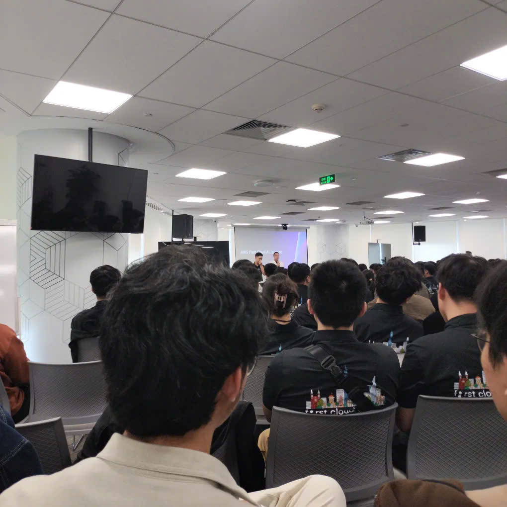
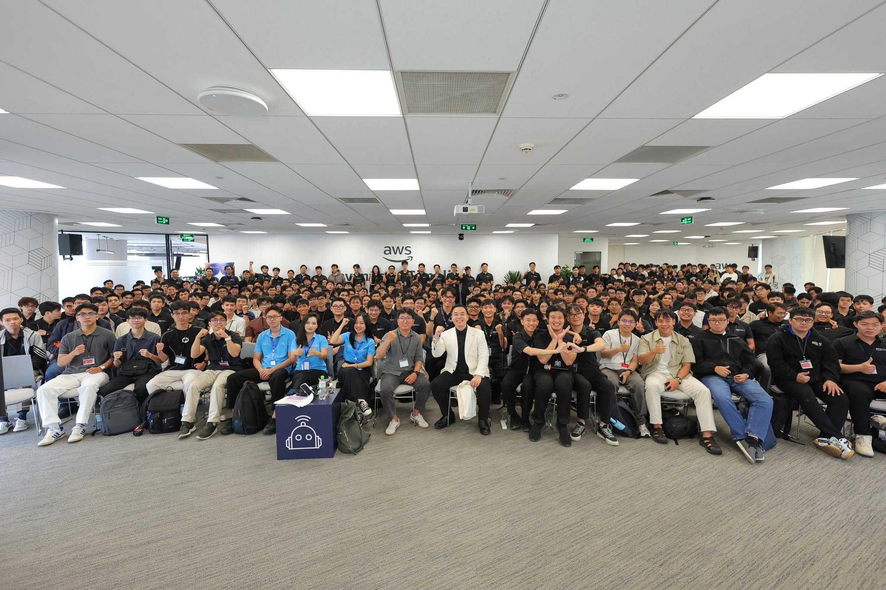

---
title: "Event 1"
date: 2026-09-26
weight: 1
chapter: false
pre: " <b> 4.1. </b> "
---

# Summary Report: “Buildrathon Kickoff: Code the Future with CMC Global”

### Event Objectives

- Introduce the Buildrathon program, its competition scope, and intended outcomes
- Connect cloud and AI skills development with talent and infrastructure investment in Vietnam
- Illustrate practical architectural patterns for organizing AI-powered applications
- Foster technical networking among students, mentors, and industry engineers at Bitexco Financial Tower

### Speakers

- **Nguyễn Gia Hưng** – Head of Solutions Architect, AWS Vietnam and Cambodia
- **Bùi Nhật Trường** – Tech Lead, CMC Global

### Key Highlights

#### Introducing Buildrathon and Cloud/AI Talent Development

- Presented the background, objectives, and strategic direction of the Buildrathon challenge.
- Connected cloud and AI capability building with ongoing investments in digital infrastructure and future engineering talent in Vietnam.
- Emphasized defining clear program objectives and scope before selecting technical solutions.

#### Market Slack Bot Architecture Example

Walked through a modular component diagram called **Market Slack Bot**, breaking down how an AI-powered bot operates across six layers:

- **Slack**: Entry point receiving mentions, direct messages, and conversation context.
- **Socket Mode / WebSocket**: Real-time connection layer linking Slack events to the bot workflow.
- **Response gate**: Control and validation checkpoint governing responses before downstream execution.
- **Claude Code**: Core AI processing component producing structured outputs (`print · JSON`).
- **SOUL.md and Memory**: Configuration layer defining bot persona, scope boundaries, and conversation context.
- **Bot schedule, internal API, cron and database**: Persistence and automation layer handling scheduled tasks, internal application functions, and data storage.

#### Architectural Evaluation Criteria for AI Applications

- Demonstrated how to evaluate an AI system end-to-end by tracing four key flows: how requests enter the system, how responses are controlled, where conversation context is stored, and how scheduled tasks are organized.

### Key Takeaways

#### Problem-First Design Mindset

- **Objective-first approach**: Always start with the program’s objective and problem scope before choosing a technical stack or AI model.
- **System-level thinking**: Focus on how components interact, validate outputs, and manage state rather than focusing solely on the AI model.

#### Modular AI Application Architecture

- **Four-pillar separation**: Organize an AI application cleanly into **request handling**, **processing**, **context management**, and **scheduled work**.
- **Controlled and structured execution**: Use response gates and structured JSON outputs (`print · JSON`) to keep AI workflows predictable and reliable.

### Applying to Work

- **Apply four-pillar separation to the Ask First project**: Structure our anti-scam Telegram bot backend cleanly across webhook ingestion, message/AI processing, DynamoDB state/consent management, and SQS scheduled follow-up reminders.
- **Implement response gating and guardrails**: Enforce strict validation rules, local PII masking, and Bedrock Guardrails before delivering automated scam warnings to elderly users and linked family members.
- **Manage conversation state reliably**: Use DynamoDB with TTL policies to track user consent, multi-message debouncing, and guardian alert acknowledgments without retaining stale context.
- **Enforce structured data contracts**: Define strict JSON schemas between the Java backend and Python AI pipeline to ensure predictable integration and automated testing.

### Event Experience

Attending the **“Buildrathon Kickoff: Code the Future with CMC Global”** on September 26, 2026 at Bitexco Financial Tower gave me a clear perspective on how real-world AI assistants are architected beyond simple prompt-response demos. Key experiences included:

#### Learning from industry leaders
- **Nguyễn Gia Hưng** (Head of Solutions Architect, AWS Vietnam and Cambodia) shared valuable context on Vietnam's cloud and AI ecosystem and how Buildrathon bridges academic learning with industry expectations.
- **Bùi Nhật Trường** (Tech Lead, CMC Global) walked through a concrete, production-oriented blueprint for an AI-powered Slack bot.

#### Architectural and technical exposure
- Analyzed the **Market Slack Bot** diagram to see how **Socket Mode / WebSocket**, **Response gates**, and **Memory** work together to control conversation flow.
- Understood why separating **request handling**, **processing**, **context management**, and **scheduled work** makes AI bots easier to debug, scale, and maintain.

#### Networking and discussions
- Connected with fellow First Cloud AI Journey interns and engineers at Bitexco Financial Tower, exchanging ideas on structuring backend workflows and state storage for AI-assisted applications.

#### Lessons learned
- Starting with clear problem boundaries prevents over-engineering during hackathons and internships.
- Building reliable AI applications depends heavily on surrounding engineering components—gates, memory stores, structured JSON outputs, and scheduled jobs—rather than the LLM alone.

#### Some event photos
- 
  *Speaker's presentation during the kickoff session.*
- 
  *Personal photo attending the event.*
- 
  *Wrap-up group photo at the event.*

> Overall, the kickoff event not only clarified the direction of Buildrathon but also provided a practical architectural blueprint that I directly applied to structuring our serverless AI bot backend.