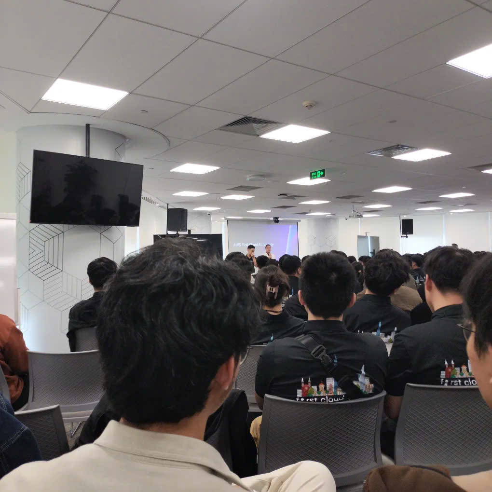
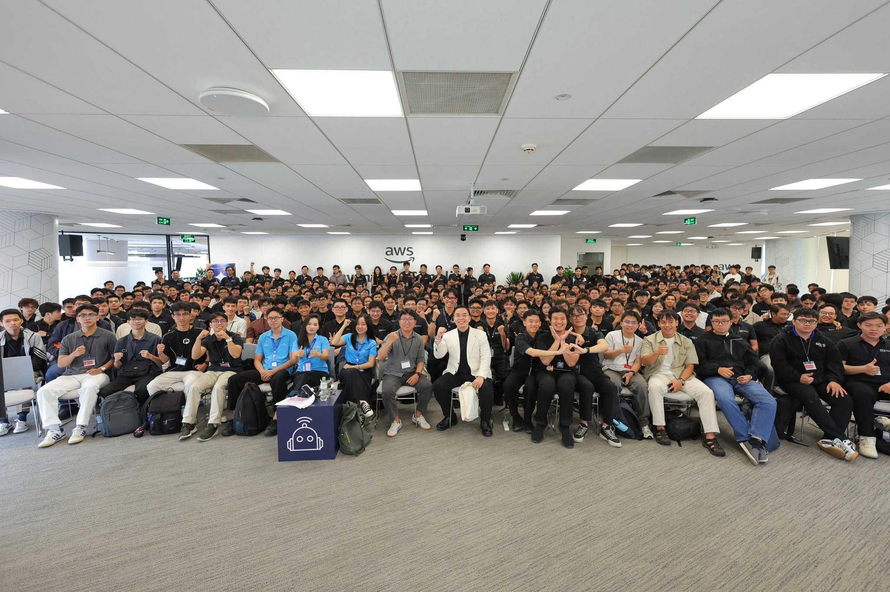

---
title: "Sự kiện 1"
date: 2026-09-26
weight: 1
chapter: false
pre: " <b> 4.1. </b> "
---

# Báo cáo tóm tắt: “Buildrathon Kickoff: Code the Future with CMC Global”

### Mục tiêu sự kiện

- Giới thiệu tổng quan về chương trình Buildrathon, phạm vi cuộc thi và các mục tiêu đầu ra kỳ vọng
- Kết nối việc phát triển kỹ năng Cloud và AI với định hướng đầu tư nhân lực và hạ tầng công nghệ tại Việt Nam
- Minh họa các mẫu kiến trúc thực tế khi tổ chức và xây dựng ứng dụng tích hợp AI
- Tạo cơ hội giao lưu, kết nối kỹ thuật giữa sinh viên, mentor và các kỹ sư tại tòa nhà Bitexco Financial Tower

### Diễn giả

- **Nguyễn Gia Hưng** – Head of Solutions Architect, AWS Vietnam and Cambodia
- **Bùi Nhật Trường** – Tech Lead, CMC Global

### Nội dung nổi bật

#### Giới thiệu Buildrathon và phát triển nhân lực Cloud/AI

- Trình bày bối cảnh, mục tiêu và định hướng của thử thách Buildrathon.
- Gắn kết việc rèn luyện kỹ năng điện toán đám mây và AI với làn sóng đầu tư vào hạ tầng số và nguồn nhân lực công nghệ tương lai tại Việt Nam.
- Nhấn mạnh tầm quan trọng của việc xác định rõ mục tiêu và phạm vi bài toán trước khi lựa chọn giải pháp kỹ thuật.

#### Ví dụ kiến trúc Market Slack Bot

Phiên chia sẻ kỹ thuật phân tích sơ đồ kiến trúc **Market Slack Bot**, minh họa cách một chatbot AI vận hành qua 6 thành phần chính:

- **Slack**: Điểm tiếp nhận các lượt nhắc tên (mentions), tin nhắn trực tiếp và ngữ cảnh hội thoại.
- **Socket Mode / WebSocket**: Lớp kết nối thời gian thực đưa sự kiện từ Slack vào luồng xử lý của bot.
- **Response gate**: Cổng kiểm soát và xác thực phản hồi trước khi chuyển sang bước xử lý tiếp theo.
- **Claude Code**: Thành phần xử lý AI cốt lõi, xuất dữ liệu có cấu trúc dưới dạng `print · JSON`.
- **SOUL.md và Memory**: Lớp cấu hình giọng điệu, phạm vi hoạt động và lưu trữ ngữ cảnh hội thoại.
- **Bot schedule, internal API, cron và database**: Lớp tự động hóa và lưu trữ đảm nhiệm tác vụ định kỳ, các hàm nghiệp vụ nội bộ và cơ sở dữ liệu.

#### Tiêu chí đánh giá kiến trúc ứng dụng AI

- Minh họa cách đánh giá toàn diện một kiến trúc AI thông qua 4 luồng cốt lõi: cách yêu cầu đi vào hệ thống, cách kiểm soát phản hồi đầu ra, nơi lưu trữ ngữ cảnh hội thoại và cách tổ chức các tác vụ chạy định kỳ.

### Bài học cốt lõi

#### Tư duy thiết kế xuất phát từ bài toán

- **Ưu tiên mục tiêu và phạm vi**: Luôn bắt đầu từ mục tiêu và phạm vi của bài toán trước khi lựa chọn công nghệ hay mô hình AI.
- **Tư duy hệ thống tổng thể**: Chú trọng cách các thành phần tương tác, kiểm soát luồng dữ liệu và quản lý trạng thái thay vì chỉ tập trung vào bản thân mô hình AI.

#### Kiến trúc ứng dụng AI mô-đun hóa

- **Phân tách 4 trụ cột**: Tổ chức ứng dụng AI rõ ràng theo 4 phần: **tiếp nhận yêu cầu (request handling)**, **xử lý nghiệp vụ (processing)**, **quản lý ngữ cảnh (context management)** và **tác vụ định kỳ (scheduled work)**.
- **Thực thi có kiểm soát và có cấu trúc**: Sử dụng các cổng kiểm soát phản hồi (response gate) cùng định dạng đầu ra JSON chuẩn hóa (`print · JSON`) để đảm bảo luồng xử lý AI ổn định và dễ kiểm chứng.

### Áp dụng vào công việc

- **Áp dụng mô hình phân tách 4 trụ cột vào dự án Ask First**: Tổ chức phần Backend của bot Telegram phòng chống lừa đảo tách bạch giữa tiếp nhận webhook, xử lý tin nhắn/AI, quản lý trạng thái & sự đồng ý của người dùng trên DynamoDB, và nhắc nhở cảnh báo định kỳ qua SQS.
- **Xây dựng lớp kiểm soát phản hồi (Response Gate & Guardrails)**: Áp dụng các luật kiểm tra cứng, ẩn danh thông tin cá nhân cục bộ (Mask PII) và Bedrock Guardrails trước khi gửi cảnh báo lừa đảo tới người cao tuổi và người thân.
- **Quản lý ngữ cảnh và trạng thái tin cậy**: Sử dụng DynamoDB kết hợp TTL để lưu trạng thái đồng ý, gom cụm tin nhắn liên tiếp (debounce) và xác nhận đã liên hệ từ người thân.
- **Chuẩn hóa hợp đồng dữ liệu JSON**: Thiết lập JSON Schema chặt chẽ giữa Backend Java và pipeline AI Python để đảm bảo tích hợp chính xác và dễ dàng kiểm thử tự động.

### Trải nghiệm tại sự kiện

Tham dự buổi **“Buildrathon Kickoff: Code the Future with CMC Global”** vào ngày 26/09/2026 tại tòa nhà Bitexco Financial Tower giúp tôi có cái nhìn thực tế về cách thiết kế một trợ lý AI hoàn chỉnh vượt ra ngoài các bản demo hỏi-đáp đơn thuần. Những trải nghiệm đáng nhớ bao gồm:

#### Học hỏi từ các diễn giả giàu kinh nghiệm
- Anh **Nguyễn Gia Hưng** (Head of Solutions Architect, AWS Vietnam and Cambodia) chia sẻ bức tranh tổng quan về hệ sinh thái Cloud/AI tại Việt Nam và định hướng kết nối sinh viên với bài toán thực tế thông qua Buildrathon.
- Anh **Bùi Nhật Trường** (Tech Lead, CMC Global) trình bày chi tiết bản thiết kế kiến trúc thực chiến của một Slack Bot tích hợp AI.

#### Tiếp cận kiến trúc và kỹ thuật thực tế
- Phân tích sơ đồ **Market Slack Bot** để hiểu rõ cách **Socket Mode / WebSocket**, **Response gate** và **Memory** phối hợp kiểm soát luồng hội thoại.
- Nắm vững lý do việc tách biệt **tiếp nhận yêu cầu**, **xử lý**, **quản lý ngữ cảnh** và **tác vụ định kỳ** giúp hệ thống AI dễ gỡ lỗi, mở rộng và bảo trì hơn.

#### Giao lưu và thảo luận
- Gặp gỡ, trao đổi cùng các bạn thực tập sinh First Cloud AI Journey và các kỹ sư tại văn phòng Bitexco Financial Tower về cách tổ chức luồng xử lý backend và lưu trữ trạng thái cho ứng dụng AI.

#### Bài học rút ra
- Xác định rõ mục tiêu và phạm vi ngay từ đầu giúp tránh thiết kế dư thừa trong các dự án thực tập và hackathon.
- Độ tin cậy của một ứng dụng AI phụ thuộc rất lớn vào các thành phần kỹ thuật bao quanh như cổng kiểm soát, bộ nhớ ngữ cảnh, đầu ra JSON có cấu trúc và cơ chế lập lịch tác vụ.

#### Một số hình ảnh tại sự kiện
- 
  *Phần thuyết trình của diễn giả tại sự kiện.*
- 
  *Hình ảnh bản thân tham gia sự kiện.*
- 
  *Ảnh chụp tập thể tổng kết sự kiện.*

> Nhìn chung, sự kiện khởi động không chỉ giúp tôi nắm rõ định hướng của chương trình Buildrathon mà còn cung cấp một khuôn mẫu kiến trúc thực tế để áp dụng trực tiếp vào việc xây dựng hệ thống backend AI Serverless của nhóm.