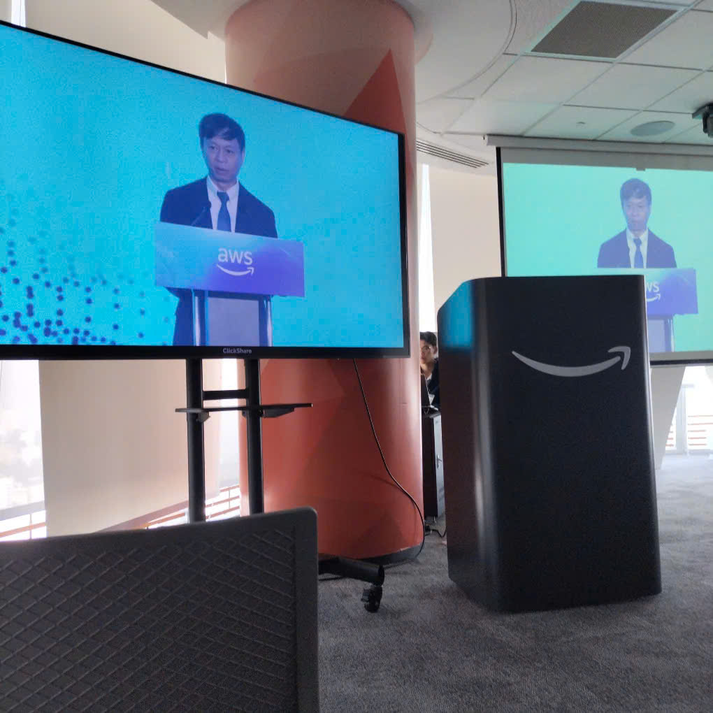
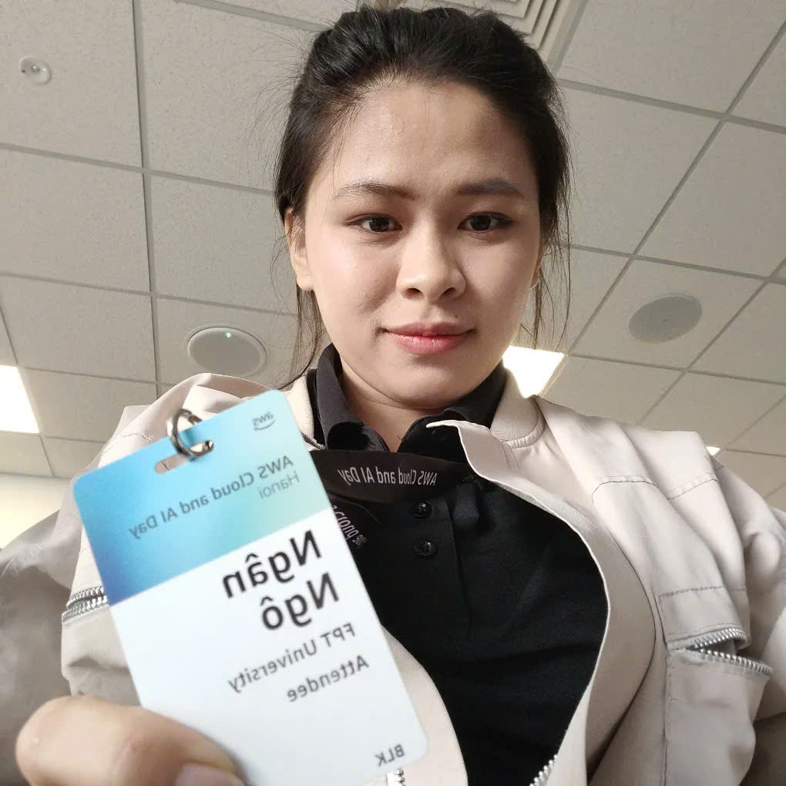
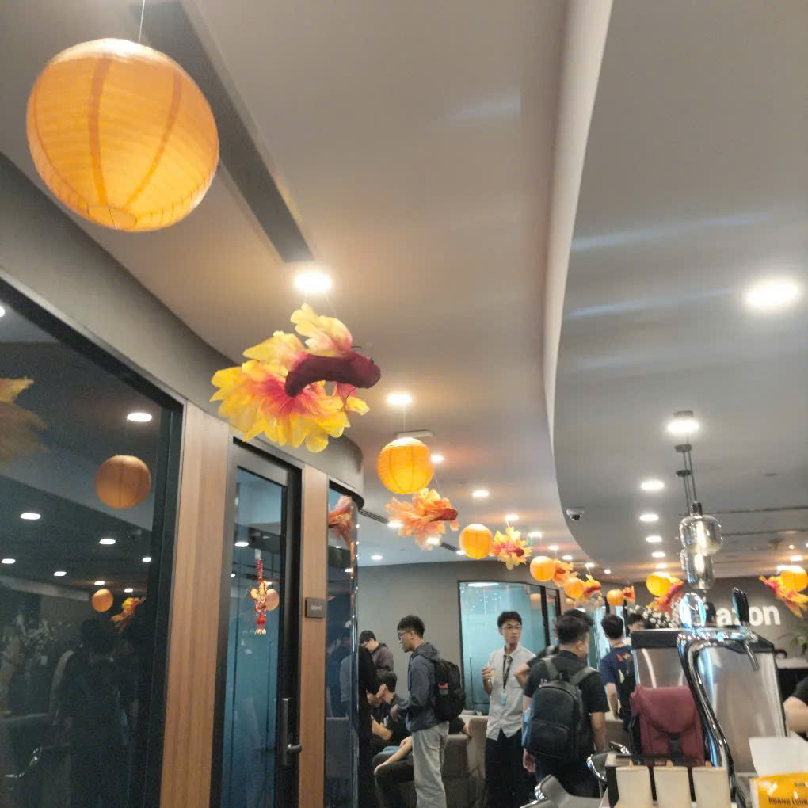

---
title: "Event 2"
date: 2026-09-29
weight: 2
chapter: false
pre: " <b> 4.2. </b> "
---

# Summary Report: “AWS Cloud and AI Day Hanoi 2026 - HCMC Watch Party”

### Event Objectives

- Explore national and enterprise cloud/AI adoption strategies and digital infrastructure trends
- Understand foundational cloud infrastructure design ("invisible engineering") behind reliable, scalable services
- Learn quality validation, observability, and security practices for AI-assisted software development
- Connect with the AWS community in Ho Chi Minh City at the Bitexco Financial Tower watch party

### Speakers

- **Hoàng Minh** – Deputy Minister of Science and Technology
- **Jennifer Wicks** – U.S. Ambassador to Vietnam
- **Eric Yeo** – Country General Manager Malaysia, Vietnam, Indochina, AWS
- **Dr. Jens Lottner** – CEO, Techcombank
- **Dr. Werner Vogels** – CTO, Amazon.com
- **Mai Le** – Director of Product Management, Katalon

### Key Highlights

#### Digital Infrastructure and the Cloud/AI Ecosystem

- Highlighted how AI innovation depends on underlying compute infrastructure, skilled engineering talent, and collaboration across enterprises, government, and universities.
- Demonstrated how cloud capabilities accelerate digital transformation across sectors such as healthcare information analysis, retail monitoring, and agriculture.

#### Customer-First Problem Definition

- Emphasized defining the business problem, data readiness, and measurable outcomes before selecting cloud services or AI models.
- Illustrated real-world customer deployments where clear problem framing prevented unnecessary architectural complexity.

#### Integrating AI into Enterprise Workflows

- Shared how Techcombank embeds AI across end-to-end engineering and operational workflows rather than treating AI as an isolated chatbot.
- Covered connecting software requirements with development and testing, assisting incident triage, enforcing access governance, and upskilling staff.

#### Invisible Engineering and Distributed Systems

- **Dr. Werner Vogels** examined the foundational engineering behind cloud services: understanding data access patterns and balancing performance, isolation, and reliability.
- Showcased **AWS Nitro System**, **AWS Lambda**, and **Firecracker** as invisible infrastructure layers enabling secure multi-tenant serverless execution, alongside **Amazon Time Sync Service** and **ClockBound** for handling time accuracy in distributed systems.

#### Validating AI-Assisted Software and Managing Validation Debt

- **Mai Le** (Katalon) introduced the concept of **validation debt**—verification work that accumulates when AI accelerates code generation faster than teams can test it.
- Emphasized linking requirements, code changes, automated test cases, defects, and runtime telemetry to make evidence-based release decisions.

#### Proactive Application Security and Guardrails

- Highlighted proactive security across the software development lifecycle (such as AWS Security Agent concepts) to close the gap between rapid development speed and security testing.
- Reinforced the necessity of enterprise guardrails, strict access controls, and continuous observability.

### Key Takeaways

#### Architecture & Design Mindset

- **Problem-first approach**: Define target users, data constraints, and measurable outcomes before choosing a service or foundation model.
- **Invisible engineering foundations**: Evaluate systems across performance, isolation, reliability, and data access patterns together rather than in isolation.

#### Engineering Quality & Validation

- **Eliminate validation debt**: Pair fast AI-assisted development with traceable automated tests, structured logs, and telemetry evidence.
- **End-to-end traceability**: Connect requirements directly to verification results before shipping changes to production.

#### Governance & Accountability

- **Security by design**: Build least-privilege access governance and guardrails directly into AI workflows.
- **Human accountability**: Maintain clear human oversight for risk assessment, release approvals, and critical user decisions.

### Applying to Work

- **Enforce least-privilege IAM & security guardrails in Ask First**: Scope separate IAM roles for the `webhook`, `worker`, and `ai` Lambda functions, combine local PII masking with Amazon Bedrock Guardrails, and defang suspicious URLs before displaying them.
- **Prevent validation debt with automated evaluation**: Build a deterministic evaluation dataset and contract tests (`AiContractTest`) in CI/CD to measure recall, false-positive rates, and JSON schema compliance across prompt or model updates.
- **Strengthen runtime observability**: Emit structured logs and custom CloudWatch metrics/alarms to monitor end-to-end latency, Bedrock throttling, and fallback behavior.
- **Keep human-in-the-loop accountability**: Design the double opt-in guardian alert flow so linked family members receive timely warnings and verify suspicious transactions directly with elderly relatives.

### Event Experience

Attending the **“AWS Cloud and AI Day Hanoi 2026 - HCMC Watch Party”** on September 29, 2026 at the 26th floor of Bitexco Financial Tower provided a comprehensive perspective on scaling cloud and AI systems responsibly. Key experiences included:

#### Learning from highly skilled speakers
- Gained insights from **Dr. Werner Vogels** on how foundational systems like Nitro, Firecracker, and ClockBound achieve isolation and reliability at cloud scale.
- Learned practical lessons from **Dr. Jens Lottner** and **Mai Le** on governing enterprise AI adoption and preventing validation debt.

#### Hands-on technical exposure
- Analyzed real architectural trade-offs around serverless compute isolation, distributed time synchronization, and proactive AppSec across the SDLC.
- Understood how telemetry, logs, and automated test evidence work together to validate non-deterministic AI components.

#### Leveraging modern tools
- Explored how AI-assisted development tools and proactive security agents accelerate delivery when paired with automated testing pipelines and guardrails.

#### Networking and discussions
- Connected with fellow First Cloud AI Journey interns and cloud enthusiasts at the HCMC watch party venue, exchanging notes on keynote takeaways and workshop architectures.

#### Lessons learned
- Development speed without traceable verification creates validation debt; tests, logs, and metrics must serve as release evidence.
- Reliable AI systems require strong access governance, privacy protection, and explicit human accountability.

#### Some event photos
- 
  *Speaker's presentation at the event.*
- 
  *Personal photo attending the event.*
- 
  *Tea break and networking area at the watch party.*

> Overall, the event bridged high-level cloud/AI strategy with deep systems engineering principles, directly shaping how I approach security, testing, and observability in my backend work.