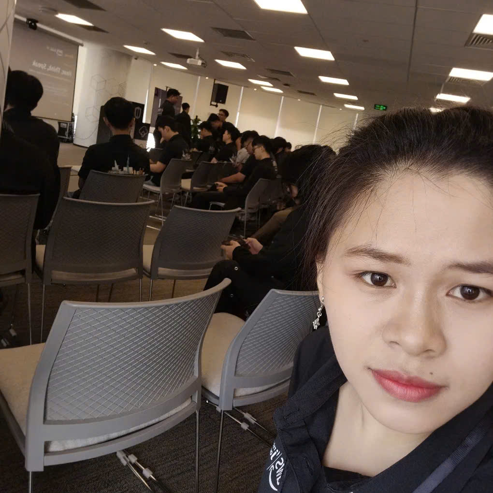
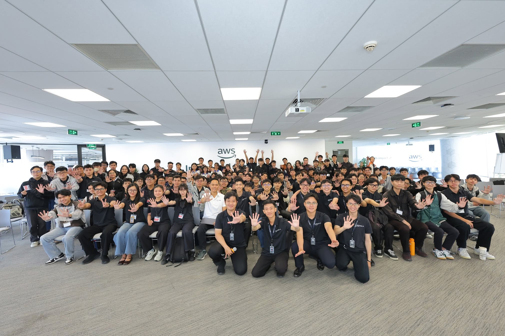

{}

⚠️ **Note:** The information below is for reference purposes only. Please **do not copy it verbatim** into your report, including this warning.

{}

# Summary Report: "First Cloud AI Journey"

### Event Objectives

- Explore practical applications of Cloud Computing and Artificial Intelligence (AI) in real-world business environments.
- Introduce AWS services and solutions for building, managing, and securing cloud-based systems.
- Understand modern AI Agent architectures and their deployment in production environments.
- Share practical approaches to cloud security, infrastructure management, and AI-powered development workflows.
- Connect students and technology enthusiasts with industry experts and the AWS community.

### Speakers

- **Kiệt Trần** – Revve AI
- **Long Huỳnh** – Styl Solution
- **Thịnh Nguyễn** – Styl Solution
- **Xuân An** – Leader, AWS Student Builder Group HCMUTE
- **Khoa Kiều** – Tech Lead, ACB
- **Nghi Danh** – AWS Community Builder

### Key Highlights

#### Building a Vietnamese Voice AI Contact Center on AWS

- **Low-latency Voice AI**: Explored an architecture capable of reducing conversational latency to approximately 1.8 seconds.
- **Natural voice interaction**: Demonstrated how AI can understand and respond to Vietnamese speech in real time.
- **Practical application**: A live AI phone interview demonstrated how Voice AI could support preliminary recruitment interviews for Cloud Engineer positions.
- **Key insight**: Low latency is essential for creating natural and seamless human-AI conversations.

#### AWS Resource Access Manager (AWS RAM)

- **Cross-account resource sharing**: Learned how to securely share AWS resources across multiple accounts within an AWS Organization.
- **Cost optimization**: Reduce duplicated resources by sharing infrastructure between accounts.
- **Centralized network management**: Simplify network administration through shared networking resources.
- **IAM and SCP integration**: Combine Identity and Access Management (IAM) policies with Service Control Policies (SCPs) to enforce permission boundaries and prevent excessive access.

#### AWS Penetration Testing with AWS Continuum / Security Agent

- **Infrastructure security assessment**: Evaluate cloud infrastructure security at an early stage.
- **Terraform code review**: Automatically inspect Infrastructure as Code (IaC) configurations to identify potential security issues.
- **CI/CD integration**: Integrate security checks directly into GitHub/GitLab Pull Request workflows.
- **Automated penetration testing**: Use Security Agents to simulate real-user activities and test application security in System Integration Testing (SIT) and User Acceptance Testing (UAT) environments before production deployment.
- **Key insight**: Security should be integrated throughout the development lifecycle rather than treated as a final deployment step.

#### Amazon Bedrock AgentCore

- **Agent Runtime**: Explored the infrastructure for deploying AI Agents into production, including MicroVM-based execution environments running on EC2 Spot Instances for cost efficiency.
- **Agent Memory**: Learned how AI Agents maintain contextual information through two memory layers:
  - **Short-term Memory**: Maintains recent conversational context with synchronization for immediate access.
  - **Long-term Memory**: Processes and stores information asynchronously to support deeper contextual understanding.
- **Production readiness**: Understood the importance of runtime isolation, memory management, and infrastructure efficiency when operating AI Agents at scale.

#### Kiro Crew

- **24/7 AI Agent operations**: Explored the concept of continuously running AI Agents to support code reviews and system monitoring.
- **Automated artifact generation**: Agents can collect real-world job market data and generate visual statistical reports directly within the chat interface.
- **Context Window Management**:
  - **Auto Compact**: Automatically compresses conversation context when token usage approaches a threshold of approximately 70–90%.
  - **Break Down Context**: Provides a more detailed breakdown of token consumption across different context components.
- **Memory Management**: Remove outdated or unnecessary memories to prevent context accumulation and control operational costs.
- **Guardrails and security**: Establish protective mechanisms to prevent AI Agents from performing dangerous infrastructure operations, such as accidentally deleting resources or exposing server secrets and credentials.

### Key Takeaways

#### Cloud Infrastructure and Resource Management

- **Cross-account architecture**: AWS Organizations and AWS RAM provide mechanisms for sharing resources while maintaining account-level separation.
- **Least privilege principle**: IAM policies and SCPs work together to restrict access and enforce security boundaries.
- **Cost efficiency**: Sharing infrastructure and choosing appropriate compute resources can help optimize cloud operating costs.
- **Centralized governance**: Managing permissions and resources systematically becomes increasingly important as cloud environments grow.

#### Security and DevSecOps

- **Shift-left security**: Security checks should begin during infrastructure design and development.
- **Infrastructure as Code security**: Terraform configurations should be reviewed before infrastructure deployment.
- **Automated security testing**: Integrating security tools into CI/CD pipelines helps identify vulnerabilities earlier.
- **Defense in depth**: Combining access control, automated testing, and AI Guardrails helps reduce security risks.

#### AI Agent Architecture

- **Production-oriented design**: Building an AI Agent requires more than connecting an LLM to an application. Runtime environments, memory, security, and monitoring are also essential.
- **Memory architecture**: Short-term and long-term memory serve different purposes in maintaining useful contextual information.
- **Context optimization**: Managing token consumption and compressing unnecessary context can improve efficiency and reduce costs.
- **Autonomous operations**: AI Agents can continuously perform tasks such as code review, monitoring, and information analysis when provided with appropriate permissions and safeguards.

#### Responsible AI and Operational Security

- **Guardrails**: Establish boundaries to prevent AI Agents from executing harmful or unauthorized actions.
- **Credential protection**: Sensitive information such as access keys, passwords, and server credentials must never be exposed to AI Agents unnecessarily.
- **Controlled autonomy**: Autonomous agents should operate with restricted permissions and human oversight for critical operations.
- **Resource protection**: Destructive infrastructure operations should require additional authorization and safeguards.

### Applying to Work

- **Explore AWS RAM**: Practice sharing selected AWS resources between accounts and understand how IAM policies and SCPs control access.
- **Improve infrastructure security**: Experiment with Terraform security reviews and integrate automated checks into GitHub workflows.
- **Explore AgentCore**: Investigate how Agent Runtime and Memory can support the deployment of production-ready AI Agents.
- **Improve AI Agent architecture**: Experiment with short-term and long-term memory to maintain conversational context.
- **Optimize AI development workflows**: Apply context management techniques and monitor token consumption when working with AI coding tools.
- **Implement security guardrails**: Restrict AI Agent permissions and protect sensitive credentials when automating development and infrastructure tasks.

### Event Experience

Attending the **"First Cloud AI Journey"** meetup at Bitexco Financial Tower on October 24, 2026, was a valuable opportunity to explore the practical intersection of Cloud Computing, AI, and modern software engineering.

#### Learning from highly skilled speakers

- Gained practical insights from experienced Tech Leads, engineers, and AWS community members.
- Learned how organizations apply AWS services to solve real-world problems involving infrastructure management, security, and AI applications.
- Discovered different approaches to building and operating AI-powered systems in production environments.

#### Exploring real-world technical solutions

- The live demonstration of a Vietnamese Voice AI conducting a recruitment interview was particularly impressive.
- Learned how AWS RAM enables secure resource sharing across multiple accounts.
- Explored how automated security agents can identify vulnerabilities before production deployment.
- Gained a better understanding of AgentCore's runtime and memory architecture.

#### Understanding the future of AI-powered development

- The Kiro Crew session was particularly interesting because it demonstrated how AI Agents can operate continuously to support code reviews and system monitoring.
- Learned about context window optimization, token consumption, and memory management.
- Understood why security guardrails are necessary when granting AI Agents access to development tools and infrastructure.

#### Networking and discussions

- Had the opportunity to learn from industry professionals and connect with other students and technology enthusiasts.
- The technical discussions and Q&A sessions provided additional perspectives beyond the presentation materials.
- Recognized the importance of actively participating in technology communities to exchange knowledge and learn from real-world experiences.

#### Lessons learned

- Cloud architecture must balance **security, scalability, performance, and cost efficiency**.
- Security should be integrated into every stage of the software development lifecycle.
- Production-ready AI Agents require proper runtime environments, memory management, and security controls.
- Autonomous AI systems need clearly defined permissions and guardrails to operate safely.
- Continuous learning, networking, and active participation in technical communities are essential for professional growth.

#### Some event photos
- 
  *Personal photo attending the event.*
- 
  *Group photo at the event wrap-up.*

> Overall, the meetup broadened my understanding of how Cloud Computing and AI are being applied in real-world business environments. More importantly, it helped me realize that learning technology is not just about understanding individual services or tools, but also about understanding how different components work together to build secure, efficient, and reliable systems. The experience motivated me to become more confident in networking, actively participate in technical discussions, and continue developing my knowledge throughout my Cloud and AI journey.