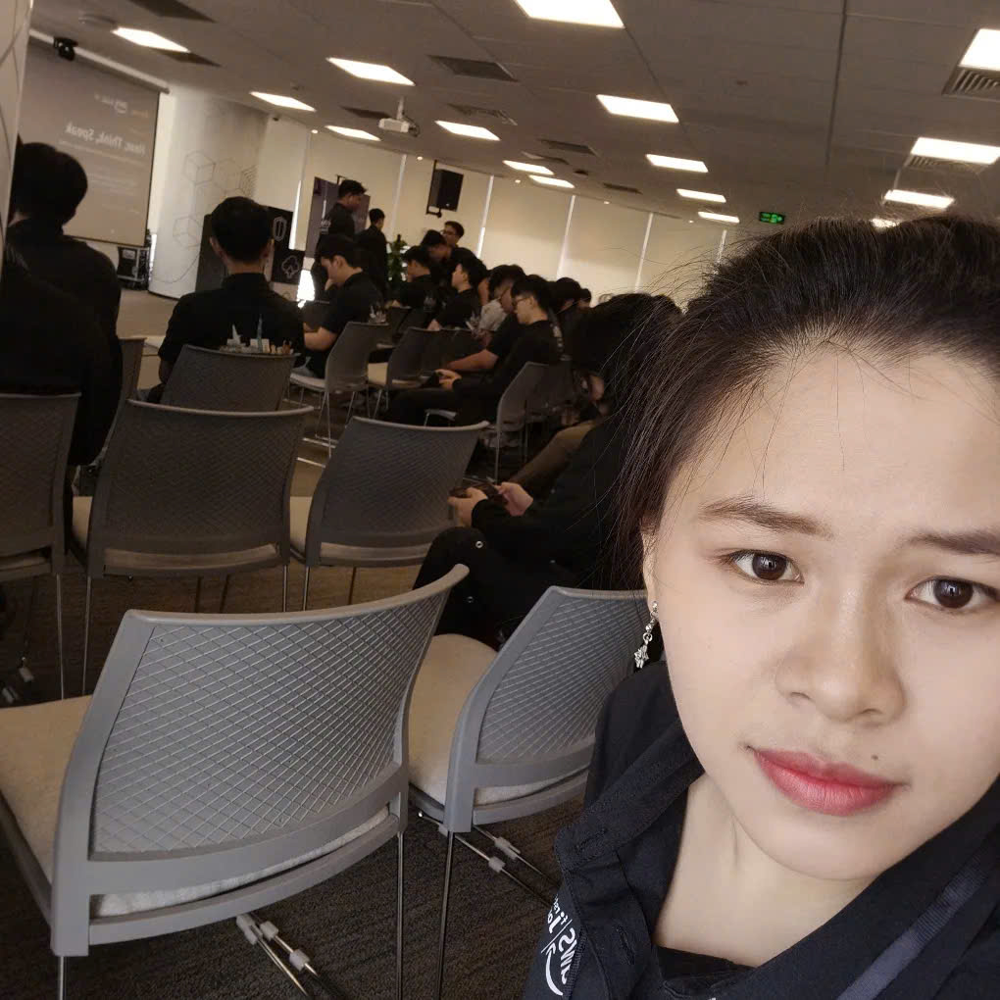
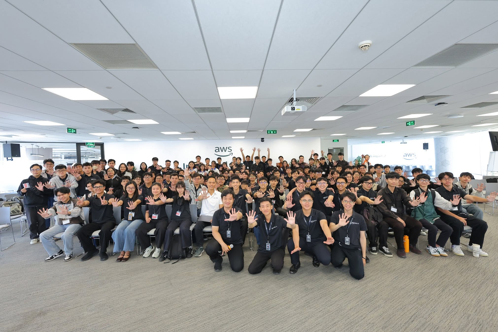

# Báo cáo tổng kết: "First Cloud AI Journey"

### Mục tiêu sự kiện

- Khám phá các ứng dụng thực tế của Cloud Computing và Trí tuệ nhân tạo (AI) trong môi trường doanh nghiệp.
- Giới thiệu các dịch vụ và giải pháp AWS phục vụ việc xây dựng, quản lý và bảo mật hệ thống trên nền tảng đám mây.
- Tìm hiểu kiến trúc AI Agent hiện đại và cách triển khai chúng trong môi trường production.
- Chia sẻ các phương pháp thực tiễn về bảo mật cloud, quản lý hạ tầng và ứng dụng AI trong quy trình phát triển phần mềm.
- Tạo cơ hội kết nối giữa sinh viên, những người yêu thích công nghệ và các chuyên gia trong ngành cũng như cộng đồng AWS.

### Diễn giả

- **Kiệt Trần** – Revve AI
- **Long Huỳnh** – Styl Solution
- **Thịnh Nguyễn** – Styl Solution
- **Xuân An** – Leader, AWS Student Builder Group HCMUTE
- **Khoa Kiều** – Tech Lead, ACB
- **Nghi Danh** – AWS Community Builder

### Những nội dung nổi bật

#### Xây dựng hệ thống Voice AI Contact Center tiếng Việt trên AWS

- **Voice AI có độ trễ thấp**: Tìm hiểu kiến trúc có khả năng giảm độ trễ hội thoại xuống khoảng 1,8 giây.
- **Tương tác giọng nói tự nhiên**: Trình diễn khả năng AI nhận diện và phản hồi tiếng Việt theo thời gian thực.
- **Ứng dụng thực tế**: Live demo AI thực hiện cuộc gọi phỏng vấn sơ tuyển vị trí Cloud Engineer bằng tiếng Việt.
- **Điểm đáng chú ý**: Độ trễ thấp là yếu tố quan trọng để tạo ra trải nghiệm hội thoại tự nhiên và liền mạch giữa con người với AI.

#### AWS Resource Access Manager (AWS RAM)

- **Chia sẻ tài nguyên giữa các tài khoản**: Tìm hiểu cách chia sẻ tài nguyên AWS an toàn giữa nhiều tài khoản trong cùng AWS Organization.
- **Tối ưu chi phí**: Hạn chế việc tạo các tài nguyên trùng lặp bằng cách chia sẻ hạ tầng giữa các tài khoản.
- **Quản lý mạng tập trung**: Đơn giản hóa việc quản trị mạng thông qua các tài nguyên mạng được chia sẻ.
- **Kết hợp IAM và SCP**: Sử dụng chính sách Identity and Access Management (IAM) cùng Service Control Policies (SCPs) để thiết lập giới hạn quyền truy cập và ngăn chặn việc cấp quyền vượt quá phạm vi cho phép.

#### Kiểm thử xâm nhập AWS với AWS Continuum / Security Agent

- **Đánh giá bảo mật hạ tầng**: Kiểm tra mức độ an toàn của hạ tầng cloud ngay từ giai đoạn đầu.
- **Kiểm tra mã Terraform**: Tự động rà soát các cấu hình Infrastructure as Code (IaC) nhằm phát hiện những vấn đề bảo mật tiềm ẩn.
- **Tích hợp CI/CD**: Tích hợp các bước kiểm tra bảo mật trực tiếp vào quy trình Pull Request trên GitHub/GitLab.
- **Kiểm thử xâm nhập tự động**: Sử dụng Security Agent mô phỏng hoạt động của người dùng thực tế để kiểm tra bảo mật ứng dụng trong môi trường System Integration Testing (SIT) và User Acceptance Testing (UAT) trước khi triển khai production.
- **Điểm đáng chú ý**: Bảo mật cần được tích hợp xuyên suốt vòng đời phát triển phần mềm thay vì chỉ thực hiện ở bước cuối cùng trước khi triển khai.

#### Amazon Bedrock AgentCore

- **Agent Runtime**: Tìm hiểu hạ tầng phục vụ triển khai AI Agent trong môi trường production, bao gồm môi trường thực thi dựa trên MicroVM chạy trên EC2 Spot Instances nhằm tối ưu chi phí.
- **Agent Memory**: Tìm hiểu cách AI Agent duy trì thông tin ngữ cảnh thông qua hai lớp bộ nhớ:
  - **Short-term Memory**: Lưu giữ ngữ cảnh hội thoại gần nhất và hỗ trợ đồng bộ để truy xuất nhanh.
  - **Long-term Memory**: Xử lý và lưu trữ thông tin bất đồng bộ nhằm hỗ trợ khả năng hiểu ngữ cảnh sâu hơn.
- **Khả năng vận hành production**: Hiểu được tầm quan trọng của việc cô lập môi trường thực thi, quản lý bộ nhớ và tối ưu hạ tầng khi vận hành AI Agent ở quy mô lớn.

#### Kiro Crew

- **Vận hành AI Agent 24/7**: Khám phá khả năng duy trì các AI Agent hoạt động liên tục để hỗ trợ review code và giám sát hệ thống.
- **Tự động tạo Artifacts**: AI Agent có thể thu thập dữ liệu việc làm thực tế và tạo các báo cáo thống kê trực quan ngay trong giao diện chat.
- **Quản lý Context Window**:
  - **Auto Compact**: Tự động nén ngữ cảnh hội thoại khi lượng token sử dụng tiến gần đến ngưỡng khoảng 70–90%.
  - **Break Down Context**: Cung cấp thông tin chi tiết về lượng token tiêu thụ của từng thành phần trong context.
- **Quản lý Memory**: Loại bỏ những memory cũ hoặc không cần thiết để tránh tích lũy ngữ cảnh và kiểm soát chi phí vận hành.
- **Guardrails và bảo mật**: Thiết lập các cơ chế bảo vệ để ngăn AI Agent thực hiện những thao tác nguy hiểm đối với hạ tầng, chẳng hạn như vô tình xóa tài nguyên hoặc làm lộ secret và credential của máy chủ.

### Những kiến thức rút ra

#### Hạ tầng Cloud và quản lý tài nguyên

- **Kiến trúc đa tài khoản**: AWS Organizations và AWS RAM cung cấp cơ chế chia sẻ tài nguyên giữa các tài khoản nhưng vẫn duy trì sự phân tách ở cấp độ tài khoản.
- **Nguyên tắc đặc quyền tối thiểu**: IAM policy và SCP phối hợp với nhau để giới hạn quyền truy cập và thiết lập ranh giới bảo mật.
- **Tối ưu chi phí**: Chia sẻ hạ tầng và lựa chọn tài nguyên compute phù hợp giúp tối ưu chi phí vận hành cloud.
- **Quản trị tập trung**: Việc quản lý quyền truy cập và tài nguyên một cách có hệ thống ngày càng quan trọng khi quy mô hạ tầng cloud mở rộng.

#### Bảo mật và DevSecOps

- **Shift-left Security**: Các bước kiểm tra bảo mật cần được thực hiện ngay từ giai đoạn thiết kế và phát triển hạ tầng.
- **Bảo mật Infrastructure as Code**: Cấu hình Terraform cần được rà soát trước khi triển khai hạ tầng.
- **Kiểm thử bảo mật tự động**: Tích hợp công cụ bảo mật vào CI/CD pipeline giúp phát hiện lỗ hổng sớm hơn.
- **Defense in Depth**: Kết hợp kiểm soát quyền truy cập, kiểm thử tự động và AI Guardrails để giảm thiểu rủi ro bảo mật.

#### Kiến trúc AI Agent

- **Thiết kế hướng production**: Xây dựng một AI Agent không chỉ đơn giản là kết nối LLM với ứng dụng. Môi trường thực thi, bộ nhớ, bảo mật và giám sát cũng là những thành phần thiết yếu.
- **Kiến trúc bộ nhớ**: Short-term Memory và Long-term Memory có những vai trò khác nhau trong việc duy trì thông tin ngữ cảnh.
- **Tối ưu Context**: Quản lý lượng token tiêu thụ và nén những ngữ cảnh không cần thiết giúp cải thiện hiệu suất và giảm chi phí.
- **Vận hành tự động**: AI Agent có thể liên tục thực hiện các nhiệm vụ như review code, giám sát hệ thống và phân tích thông tin khi được cấp quyền phù hợp và có cơ chế bảo vệ.

#### AI có trách nhiệm và bảo mật vận hành

- **Guardrails**: Thiết lập các giới hạn nhằm ngăn AI Agent thực hiện những hành động gây hại hoặc không được cho phép.
- **Bảo vệ Credential**: Những thông tin nhạy cảm như access key, mật khẩu và credential của máy chủ không nên bị tiết lộ cho AI Agent một cách không cần thiết.
- **Kiểm soát quyền tự chủ**: AI Agent cần hoạt động với quyền hạn giới hạn và có sự giám sát của con người đối với những thao tác quan trọng.
- **Bảo vệ tài nguyên**: Những thao tác có khả năng phá hủy hạ tầng cần có thêm cơ chế xác nhận và bảo vệ.

### Áp dụng vào công việc và dự án

- **Khám phá AWS RAM**: Thực hành chia sẻ một số tài nguyên AWS giữa các tài khoản và tìm hiểu cách IAM policy cùng SCP kiểm soát quyền truy cập.
- **Cải thiện bảo mật hạ tầng**: Thử nghiệm kiểm tra bảo mật Terraform và tích hợp các bước kiểm tra tự động vào GitHub workflow.
- **Tìm hiểu AgentCore**: Nghiên cứu cách Agent Runtime và Memory hỗ trợ triển khai AI Agent trong môi trường production.
- **Cải thiện kiến trúc AI Agent**: Thử nghiệm Short-term Memory và Long-term Memory để duy trì ngữ cảnh hội thoại.
- **Tối ưu quy trình phát triển với AI**: Áp dụng các kỹ thuật quản lý context và theo dõi lượng token tiêu thụ khi sử dụng công cụ AI hỗ trợ lập trình.
- **Triển khai Security Guardrails**: Giới hạn quyền của AI Agent và bảo vệ credential nhạy cảm khi tự động hóa các tác vụ phát triển phần mềm và quản lý hạ tầng.

### Trải nghiệm tại sự kiện

Tham gia buổi meetup **"First Cloud AI Journey"** tại Bitexco Financial Tower vào ngày 24/10/2026 là một trải nghiệm có giá trị, giúp mình khám phá sự kết hợp thực tế giữa Cloud Computing, AI và kỹ thuật phát triển phần mềm hiện đại.

#### Học hỏi từ các chuyên gia trong ngành

- Tiếp thu những chia sẻ thực tiễn từ các Tech Lead, kỹ sư giàu kinh nghiệm và thành viên cộng đồng AWS.
- Tìm hiểu cách các doanh nghiệp ứng dụng dịch vụ AWS để giải quyết những bài toán thực tế liên quan đến quản lý hạ tầng, bảo mật và ứng dụng AI.
- Khám phá nhiều cách tiếp cận khác nhau trong việc xây dựng và vận hành các hệ thống ứng dụng AI trong môi trường production.

#### Tiếp cận các giải pháp kỹ thuật thực tế

- Phần trình diễn Voice AI tiếng Việt thực hiện cuộc gọi phỏng vấn tuyển dụng là một trong những điểm ấn tượng nhất.
- Hiểu thêm cách AWS RAM hỗ trợ chia sẻ tài nguyên an toàn giữa nhiều tài khoản.
- Khám phá cách các Security Agent tự động phát hiện lỗ hổng trước khi triển khai production.
- Có cái nhìn rõ ràng hơn về kiến trúc Runtime và Memory của AgentCore.

#### Tìm hiểu tương lai của phát triển phần mềm với AI

- Session Kiro Crew đặc biệt thu hút vì trình bày cách AI Agent có thể hoạt động liên tục để hỗ trợ review code và giám sát hệ thống.
- Tìm hiểu về tối ưu Context Window, quản lý token và quản lý Memory.
- Hiểu được lý do cần có Security Guardrails khi cấp quyền cho AI Agent truy cập vào các công cụ phát triển và hạ tầng.

#### Kết nối và trao đổi kiến thức

- Có cơ hội học hỏi từ các chuyên gia trong ngành và kết nối với những sinh viên, người yêu thích công nghệ khác.
- Các cuộc thảo luận kỹ thuật và phần hỏi đáp cuối buổi mang đến nhiều góc nhìn bổ ích bên cạnh nội dung trình bày.
- Nhận ra tầm quan trọng của việc chủ động tham gia các cộng đồng công nghệ để trao đổi kiến thức và học hỏi kinh nghiệm thực tế.

#### Những bài học rút ra

- Kiến trúc Cloud cần cân bằng giữa **bảo mật, khả năng mở rộng, hiệu suất và tối ưu chi phí**.
- Bảo mật cần được tích hợp trong mọi giai đoạn của vòng đời phát triển phần mềm.
- AI Agent sẵn sàng cho production cần có môi trường thực thi phù hợp, cơ chế quản lý bộ nhớ và các biện pháp bảo mật.
- Các hệ thống AI tự chủ cần có quyền hạn được xác định rõ ràng và cơ chế bảo vệ để vận hành an toàn.
- Học hỏi liên tục, kết nối và chủ động tham gia cộng đồng công nghệ là những yếu tố quan trọng đối với sự phát triển nghề nghiệp.

#### Một số hình ảnh tại sự kiện
- 
  *Hình ảnh bản thân tham gia sự kiện.*
- 
  *Ảnh chụp tập thể tổng kết sự kiện.*

> Nhìn chung, buổi meetup đã mở rộng hiểu biết của mình về cách Cloud Computing và AI đang được ứng dụng trong môi trường doanh nghiệp thực tế. Quan trọng hơn, mình nhận ra rằng việc học công nghệ không chỉ dừng lại ở việc hiểu từng dịch vụ hay công cụ riêng lẻ, mà còn cần hiểu cách các thành phần phối hợp với nhau để xây dựng những hệ thống an toàn, hiệu quả và đáng tin cậy. Trải nghiệm này cũng tạo thêm động lực để mình tự tin hơn trong giao tiếp, chủ động tham gia các cuộc thảo luận kỹ thuật và tiếp tục phát triển kiến thức trên hành trình Cloud và AI của bản thân.